# Estructura de Datos

## Fundamentos: ¿Cómo entiende la computadora el mundo real?

Una computadora solo administra ceros y unos (`0` y `1`). Para que un programa resuelva problemas reales (como registrar una cédula, cobrar una multa o guardar un nombre), necesitamos **darle significado y reglas a esos bits en memoria**.

Clasificamos esos tipos de datos según **al dominio que pertenecen** (qué abarcan). Un dominio define dos cosas:

1. **El conjunto de valores válidos** (Qué se puede guardar).

2. **Las operaciones asociadas** (Qué tenemos permitido hacer con esos valores).

Los dominios se clasifican principalmente en:

* **Dominio Numérico:** Agrupa datos como edad, año de nacimiento o número de multas. Nos permiten hacer operaciones aritméticas.

* **Dominio Texto:** Agrupa datos como nombre, dirección o cédula. No se operan matemáticamente, sino mediante operaciones de cadena (concatenar, buscar subcadenas).

### Tipos de Datos Primitivos

El **Dominio** define la regla teórica y el **Tipo Primitivo de Java** es la casilla de memoria fija diseñada para cumplir esa regla. Es decir, que para ver la idea del Dominio de un dato en la práctica, Java dispone de los tipos de datos primitivos.

Un **Tipo de Dato Primitivo** es simplemente un tipo de realización física del Dominio (lo que se procesa en el Hardware). Son los tipos de datos más básicos e indivisibles que el lenguaje de programación ofrece de forma nativa. Representan un único valor directo en memoria.

 

Con esto, se puede ver que el dominio de los `String` sería de dominio texto, el de los `int` sería de dominio numérico, y así sucesivamente.

En el mundo real, la información no suele venir aislada en variables simples. Un estudiante no es solo un `int edad` suelto (sin una clase); es un conjunto de nombre, cédula, materias y promedios. Intentar manejar eso con puras variables primitivas sueltas vuelve el código inmanejable.

### Tipos de Datos Compuestos

Surgen para agrupar varios tipos de datos simples bajo una misma estructura y así representar entidades complejas del mundo real:

* Variables que almacenan más de un valor.

* Variables que representan información de la vida real.

* Estarán formados a partir de tipos de datos simples.

En Java tenemos:

 

Note que **la clase representa un tipo de dato compuesto**, ya que una simple `class Estudiante` podría conformarse de un `String nombre`, `int edad`, `boolean estaEstudiando`, entre otras. Por lo que se evidencia un conjunto de datos primitivos agrupados.

## La necesidad de manejar la complejidad: La Abstracción

Al agrupar datos en estructuras compuestas más grandes, surge un nuevo problema: si para usar una estructura tuvieras que conocer y modificar manualmente cada detalle interno de cómo está guardada en memoria, el software se volvería frágil e inmanejable.

> **Ejemplo:** Supón que quieres conducir un carro. Si **NO usaras abstracción**, tendrías que controlar manualmente la inyección de combustible, la chispa de las bujías, la presión del aceite y mover los engranajes de la transmisión. Un error de milisegundos destruye el motor. **Con abstracción**, el fabricante solo te da una interfaz simple: el pedal del acelerador **(te importa QUÉ HACE el carro, no CÓMO lo hace)**.

Para resolver esto, la ciencia de la computación aplica el principio de **Abstracción**.

> **Abstracción:** Es una visión simplificada de la realidad en la que solo consideramos los aspectos esenciales, haciendo énfasis en el **¿QUÉ HACE?** más que en el **¿CÓMO LO HACE?**.

En programación, la abstracción ocurre en dos niveles:

1. **Abstracción de Control:** Es la utilización de procedimientos o funciones sin preocuparse de cómo están implementados internamente. Solo nos interesa qué hace la función, ocultando detalles como variables temporales o secuencias de instrucciones. *Ejemplo:* al calcular el promedio de un conjunto de datos, solo te interesa pasar los datos, no el procedimiento matemático detrás de ello.

2. **Abstracción de Datos:** Permite definir nuevos tipos de datos enfocándonos en las operaciones que podemos realizar con ellos, sin importar cómo se almacenan en memoria. De este concepto nace el **TDA**.

Se le dice **Tipo de Dato Abstracto** porque el programador que diseñará ese tipo de dato sí se cuestionará el **cómo**. Sin embargo, está destinado para que otros programadores (o incluso el mismo programador) lo usen, reduciendo todo al interés al **qué hace**.

### Tipos de Datos Abstractos (TDAs) vs. Estructuras de Datos

Se llama **Abstracto** porque define una **idea** matemática/lógica pura (por ejemplo: *"una Pila es una estructura donde el último en entrar es el primero en salir"*) que existe conceptualmente antes de convertirse en código concreto en cualquier lenguaje.

Un **TDA** es un modelo matemático (es decir, teórico) de una `Estructura de Datos` que representa entidades del mundo real o conceptos abstractos, especificando el **QUÉ** y omitiendo el **CÓMO**.

> **Estructuras de Datos:** Es la forma concreta de **organizar, almacenar y gestionar datos en la memoria RAM** de la computadora para que puedan ser accedidos y modificados de manera eficiente. Si el **TDA** es el plano arquitectónico teórico (*el qué*), la **Estructura de Datos** es la construcción física con materiales concretos en memoria (*el cómo*).

### Componentes de un TDA

Un TDA bien diseñado se compone de dos partes fundamentales:

* **Comportamiento u Operaciones (Público):** Define lo que el TDA puede hacer. Es lo único que el programador usuario puede ver y utilizar.

  * *Ejemplo:* Un carro es útil porque se puede manejar; `manejar()` es una operación del TDA Carro.

* **Propiedades o Atributos (Oculto / Encapsulado):** Es la representación interna del estado y los datos. Un TDA correctamente creado **mantiene sus propiedades ocultas**.

  * *Ejemplo:* Al conductor no le interesa cómo el motor inyecta gasolina o cómo giran los pistones; solo le interesa que el carro avance al acelerar.

## Implementación de un TDA en Java

Para llevar un TDA del papel (modelo matemático) a un lenguaje orientado a objetos como Java, el lenguaje nos permite implementarlos mediante:

1. **Interfaces (`interface`):** Representan el TDA en su estado más puro. Solo definen el **QUÉ** (la firma de los métodos/operaciones) sin incluir detalles de implementación ni variables de estado.

2. **Clases Abstractas (`abstract class`):** Un punto medio. Permiten definir el contrato pero también compartir código o atributos comunes entre diferentes implementaciones.

3. **Clases Concretas (`class`):** Representan la **Estructura de Datos real**. Implementan la interfaz y definen el **CÓMO** (cómo se organizan físicamente los datos en la memoria RAM y cómo ejecutan los algoritmos).

### Caso de Estudio: El TDA `List` en Java

El TDA **`List`** representa una colección ordenada de elementos de cualquier tipo. Note que se le dice TDA ya que estamos hablando de una interfaz. Por lo cual, solo está establecido el qué hace `List<E>`, más no cómo lo hará.

```
                     ┌──────────────────┐
                     │     List<E>      │  <-- TDA / Interfaz
                     │   <interface>    │      (Especifica el QUÉ)
                     └────────┬─────────┘
                              │
               ┌──────────────┴──────────────┐
               │                             │
    ┌──────────┴──────────┐       ┌──────────┴──────────┐
    │    ArrayList<E>     │       │    LinkedList<E>    │  <-- Estructuras de Datos
    │ (Basado en Arrays)  │       │  (Basado en Nodos)  │      (Implementan el CÓMO)
    └─────────────────────┘       └─────────────────────┘
```

#### El Contrato (La Interfaz `List<E>`)

Define las reglas que toda lista debe cumplir en Java:

* Permite añadir, eliminar y recuperar elementos.

* Permite elementos duplicados.

* Las operaciones como `add()` o `remove()` informan el éxito o fracaso de la operación.

* **Operaciones clave:** `add(E e)`, `add(int index, E element)`, `clear()`, `contains(Object o)`.

#### Separación de Roles: Usuario vs. Implementador

Existe una separación radical de roles al trabajar con TDAs:

* **Para el Programador Cliente (Usuario del TDA):**

  * Tanto `ArrayList` como `LinkedList` se comportan exactamente igual a través de la interfaz `List`.

  * No necesita saber si los datos están contiguos en memoria o enlazados por referencias.

  * *Ejemplo:* `List<String> nombres = new ArrayList<>();`

* **Para el Desarrollador de la Estructura (Implementador):**

  * Debe tomar decisiones de ingeniería sobre la representación concreta en memoria.

  * **`ArrayList`:** Almacena los elementos en un arreglo interno redimensionable. Acceso por índice ultra rápido, pero inserciones en el medio costosas.

  * **`LinkedList`:** Almacena los elementos en nodos dispersos en memoria unidos por punteros/referencias. Inserciones rápidas, pero acceso por índice lento.

## ¿Cómo podemos construir nuestras propias estructuras?

Para poder programar nuestras propias versiones de `ArrayList`, `LinkedList`, `Pilas` y `Colas` desde cero en este curso, necesitamos dominar 3 herramientas fundamentales de Java y Algoritmos:

1. **Java Generics (`<T>` / `<E>`):** Para que nuestros TDAs puedan almacenar cualquier tipo de objeto sin perder la seguridad de tipos.

2. **Notación Asintótica (Big-O):** Para medir matemáticamente si es mejor usar `ArrayList` o `LinkedList` según el problema.

3. **Recursividad:** Para resolver problemas complejos dividiéndolos en subproblemas más simples.

## De los TDAs a Java Generics

### Lo que DEBE hacer una estructura de datos

> **"La estructura y los algoritmos que gestionan los datos son totalmente independientes de la naturaleza de los datos gestionados."**

O dicho de otra forma:

> **"Una caja es una caja sin importar si guarda oro, joyas o discos duros. La lógica para abrirla, cerrarla o almacenar un elemento en ella es exactamente la misma."**

### El Dilema del Creador de TDAs

Cuando diseñas un **Tipo de Dato Abstracto (TDA)** como el TDA `List`:

* Defines las operaciones esenciales: `add()`, `remove()`, `get()`, `contains()`.

* El comportamiento matemático y la estructura lógica de una lista no cambian si guardas números enteros (`1, 2, 3`), texto (`"A", "B"`) o entidades del mundo real (`Estudiante`, `Laptop`, `Joya`).

Al traducir este modelo teórico a código Java, surgen dos problemas de diseño:

#### Opción A: Crear un TDA específico para cada tipo de dato

Escribir clases independientes como `IntArrayList`, `StringArrayList` o `StudentArrayList`.

* **Falla:** Causa **duplicación masiva de código**. No es una solución escalable ni fácil de mantener. Si se detecta un error en la lógica interna del método `add()`, habría que corregirlo en cada clase por separado.

#### Opción B: Crear un TDA utilizando la clase ancestro `Object`

Escribir una sola estructura basada en `Object`. Dado que toda clase hereda de `Object` en Java, la estructura puede almacenar cualquier tipo de elemento.

* **Falla:** Elimina la **seguridad de tipos (*Type Safety*)**. Obliga a realizar casting explícito al extraer los datos y genera riesgo de errores graves en tiempo de ejecución (*Runtime*) como un `ClassCastException` si se inserta un tipo de dato no esperado (es decir, le estás jurando a Java que sí se puede hacer un casting).

### Por qué nacen los Generics en Java

> **Corolario de Parametrización:**
> *"Para que un TDA sea verdaderamente abstracto y reutilizable, debe ser capaz de recibir el TIPO de dato como un parámetro de configuración en el momento de ser instanciado."*

**Java Generics (`<T>`)** resuelve esta necesidad al nivel del lenguaje:

1. **Abstracción Pura:** Permite escribir el algoritmo de la estructura de datos **una sola vez**.

2. **Seguridad en Tiempo de Compilación:** Evita el uso de castings manuales y permite que el compilador verifique que solo se almacenen los tipos permitidos, detectando incompatibilidades antes de ejecutar el programa.

## Java Generics (Parametrización de Tipos)

### La Evolución: De Parametrizar Datos a Parametrizar Tipos

Para entender por qué existen los Genéricos, debemos ver cómo evoluciona la reutilización de código en programación:

#### El Problema de la Duplicación Lógica

Imagina que necesitas métodos para dividir números entre valores fijos: `divideByTwo(n)`, `divideByThree(n)`, `divideByFour(n)`, ...

* **Falla:** Esta estrategia es **difícil de mantener**, **no es escalable** y es **demasiado específica**.

#### Primera Solución: Parametrización de Datos (Variables)

Pasamos el divisor como un argumento: `divideBy(int n, int divisor)`. Es lo que comúnmente llamamos **Parametrización de Datos**.

* **Ganancia:** Permite modificar el comportamiento del método enviando diferentes *valores* de datos sin reescribir la rutina. Así, hemos creado una solución **más genérica**.

#### El Nuevo Límite: ¿Y si queremos variar el TIPO de dato?

Si ahora queremos que un método o una clase funcione no solo con `int`, sino también con `String`, `Estudiante` o `Joya`, la parametrización de datos ya no alcanza. Por lo que hace falta generalizar.

* **La Solución (Parametrización de Tipos):** En lugar de pasar un *valor* como parámetro, pasamos un **TIPO DE DATO** como parámetro usando la sintaxis `<T>` **(Se la conoce como notación Diamante)**. 

La **Parametrización de Tipos** es la característica del lenguaje que permite crear clases, interfaces y métodos especificando los tipos de datos sobre los que operan mediante parámetros, en lugar de fijar un tipo de dato rígido desde el inicio.

Por otro lado, el **Parámetro de Tipo** es el identificador o símbolo *placeholder* (escrito formalmente entre llaves angulares `<>`) que representa un tipo de dato abstracto hasta que la clase o método es instanciado con un tipo real.

De esta forma, podemos crear clases, interfaces y métodos en los que los tipos de datos sobre los que opera se especifican como parámetros, obteniendo las siguientes ventajas:

* El código genérico trabaja automáticamente con el tipo de datos pasados a su parámetro de tipo.

  * *Ejemplo:* La búsqueda binaria es la misma ya sea que se esté buscando números, cadenas de caracteres, estudiantes, materias, etc.

* Con genéricos, se puede definir el algoritmo una vez y aplicarlo a varios tipos de datos sin mayor esfuerzo adicional.

### La Solución Antigua vs. La Solución Moderna

```
                  ¿Cómo almacenar cualquier tipo de dato?
                                     │
           ┌─────────────────────────┴─────────────────────────┐
           ▼                                                   ▼
 Usando Object (Antiguo)                             Usando Generics <T> (Moderno)
- Object es superclase de todos.                   - Define un parámetro de tipo <T>.
- Acepta cualquier objeto.                         - Mantiene el tipo específico en uso.
- Requiere Casts manuales.                         - No requiere Casts.
- Inseguro: Errores en Runtime.                    - Seguro: Errores en Compilación.
```

#### ¿Qué es un Genérico en Java?

Es el mecanismo general (introducido en Java 5) que permite definir estructuras y algoritmos tipo "plantilla" que funcionan automáticamente sobre cualquier tipo de dato asignado a su parámetro de tipo, garantizando seguridad en tiempo de compilación.

Como ya se ha visto, hay 2 formas de intentar lograr tipos de datos genéricos en Java:

1. Usando la clase `Object` (**NO recomendado**).

2. Usando **parámetros de tipo** (`<T>`).

### Clase `Object` para genéricos

Como se mencionó, `Object` fue la primera forma de intentar usar genéricos en Java. Esto sucedió así ya que, al ser `Object` la superclase de toda clase, una referencia de `Object` puede referirse a cualquier tipo de objeto.

 

Con esto obtenemos un método genérico. Sin embargo, considere los siguientes casos:


Al querer usar ese dato debemos hacer un casting. **¿Será que el objeto estudiante podrá ser transformado a texto?**, **¿Será que el objeto estudiante podrá ser un entero?**

Considere las siguientes observaciones al usar `Object`:

* **Casts necesarios** para convertir explícitamente de `Object` al tipo real de datos sobre los que se va a operar.

* **No es seguro:** Posibles errores durante tiempo de ejecución cuando los casts no son posibles.

### Ejemplo Práctico: Evolución de la clase `Box`

#### Implementación Rígida (Solo `String`)

Suponga que desea diseñar una clase que permita almacenar un artículo en una caja fuerte:

```java
public class Box {
  private String article = null;

  public Box(String article) {
    this.article = article;
  }

  public String getArticle() {
    return article;
  }

  public void setArticle(String article) {
    this.article = article;
  }
}
```

Prueba en el `main`:

```java
public class Main {
  public static void main(String[] args) {
    Box box1 = new Box("gold bar");
    Box box2 = new Box("crown");

    System.out.println(box1.getArticle());
    System.out.println(box2.getArticle());
  }
}
```

Con esta solución solo podríamos guardar elementos tipo `String`.

#### Intentando Generalizar con `Object`

```java
public class Box {
  private Object article = null;

  public Box(Object article) {
    this.article = article;
  }

  public Object getArticle() {
    return article;
  }

  public void setArticle(Object article) {
    this.article = article;
  }
}
```

Al probarlo en un `main`:

```java
public class Main {
  public static void main(String[] args) {
    Box box1 = new Box("gold bar");
    String article = box1.getArticle(); // ❌ Error de compilación: Object no es String
  }
}
```

Tenemos un error de compilación ya que un `Object` NO es un `String`. Por lo que tenemos que realizar un **Downcasting**:

```java
public class Main {
  public static void main(String[] args) {
    Box box1 = new Box("gold bar");
    String article = (String) box1.getArticle(); // Ok, pero peligroso e incómodo
  }
}
```

#### ¿Cuál es el problema de usar `Object` como contenedor?

Usar `Object` no es escalable en cuanto a **mantenimiento de software**:

1. **Sin Type Safety:** Permite mezclar cualquier tipo de dato en la misma estructura sin advertencias del compilador.

2. **Casteos redundantes:** Obliga al programador a realizar *downcasting* manual (`(Tipo)`) cada vez que recupera un elemento.

3. **Errores tardíos (`ClassCastException`):** Mueve la detección de errores del **tiempo de compilación** (seguro y rápido de corregir) al **tiempo de ejecución** (fallos graves en producción).

> **Conclusión:** Por estos tres problemas nacen los **Java Generics (`<T>`)**, permitiendo reutilizar código sin perder la seguridad de tipos.

#### La Solución Moderna: Clase Genérica `Box<T>`

Empleamos parametrización de tipos mediante el parámetro de tipo `<T>`:

```java
public class Box<T> {
  private T article = null;

  public Box(T article) {
    this.article = article;
  }

  public T getArticle() {
    return article;
  }

  public void setArticle(T article) {
    this.article = article;
  }
}
```

De esta forma, decimos que `Box` es **una clase genérica**. Al probarla en el `main`:

```java
public class Main {
  public static void main(String[] args) {
    Box<String> box1 = new Box<>("Joya");
    Box<Integer> box2 = new Box<>(1000);
    Box<Student> box3 = new Box<>(new Student("Adriana", "Collaguazo"));

    System.out.println(box1.getArticle());
    System.out.println(box2.getArticle());
    System.out.println(box3.getArticle());
  }
}
```

### Convenciones de Nombres para Parámetros de Tipo (`<T>`)

Por lo general, el parámetro de tipo suele denotarse con nombres simples expresados en letras mayúsculas:

* **`E` - Element:** Usado ampliamente por el Framework de Colecciones de Java (`List<E>`, `Set<E>`).

* **`K` - Key:** Representa la Clave en mapas (`Map<K, V>`).

* **`V` - Value:** Representa el Valor en mapas (`Map<K, V>`).

* **`N` - Number:** Para tipos numéricos.

* **`T` - Type:** Representa un Tipo general.

* **`S`, `U`, `V`:** Para múltiples parámetros de tipo adicionales.

### Puntos Importantes a Tener en Cuenta con `<T>`

* **Solo Tipos de Referencia (Objetos):** Los genéricos en Java no aceptan tipos primitivos directos (`int`, `double`, `boolean`, `char`). Se deben utilizar sus clases envolventes (*Wrapper classes*): `Integer`, `Double`, `Boolean`, `Character`.

* **Instancias**: Las instancias de una clase genérica con otra clase genérica pueden diferir de tipo. Por ejemplo
si tienes dos box (box1 -> String, box2 -> Integer). Realizar un box1 = box2.

* El parámetro de tipo **puede ser omitido**, pero tendrías que **realizar un Downcasting**.


## Notación Big-O / O grande / Asintótica
### ¿Qué es Big-O y por qué importa?
Si quieres saber si tu **algoritmo es rápido**, ¿por qué no simplemente usas un cronómetro? Es obvio
que el resultado **no es confiable**. Un algoritmo malo puede correr rápido en una supercomputadora,
y un algoritmo excelente puede correr lento en una tostadora xD.

Necesitábamos una forma de medir la **eficiencia independiente del hardware**. En lugar de contar segundos, la
solución es contar el **número de operaciones (pasos de la CPU)** que ejecuta el algoritmo en función del tamaño
de la **entrada (n) del algoritmo** (Como una función, por ejemplo).

Aquí es donde se conectan las Matemáticas y la Computación:

- En Matemáticas: La notación Big-O ya existía para analizar cómo se comporta una función cuando
su variable tiende al infinito.

- En Computación: Adoptamos esa misma herramienta matemática para responder: "Si la entrada n se hace
gigante (al infinito), **¿cuántas operaciones como máximo tendría que hacer la CPU?**" -> **Análisis**
**de desempaño**.

#### Análisis del desempeño
A nivel de análisis del desempeño, existen 3 tipos:
- Mejor de los casos.
- Caso promedio.
- Peor de los casos (Notación O grande).

Pero, ¿Por qué en este curso sólo nos enfocamos en el peor de los casos? 
Porque cuando **lanzamos un proyecto**, ya sea una aplicación de escritorio o móvil, nosotros
tenemos que **garantizar que esa aplicación funcione** cuando todos los usuarios las
estén usando, es decir, cuando **toda la organización la esté usando**. Eso implica evaluar
a la aplicación en su nivel de estrés más alto, dicho de otra forma, en el **peor de los casos**.


A nivel de computación, nosotros **usamos algoritmos**. Los algoritmos son secuencias
de pasos ordenados que nos ayudan a resolver un problema.

En un algoritmo pueden o no intervenir de x1 a x2, ..., xn variables (**entradas**) con el fin de 
obtener un resultado. Dicho resultado usará recursos computacionales -> **cantidad de memoria, unidades**
**de tiempo de disco duro, procesador**, ... Por lo que el **algoritmo tendrá un grado de complejidad**.

En estructura de datos, vamos a llamar a **la complejidad como el análisis del rendimiento**. 
Por tanto con Big-O evaluamos cuán complejo es un algoritmo en base a cuánta memoria utiliza, 
cuántas unidades de tiempo consume para **mostrar un resultado**. **Evaluamos la complejidad**
**en base a cuál es el peor de los casos del algoritmo** osea, cuál es el tope en complejidad
del algoritmo.

### Situación del regalo
Para entender mejor cómo interpretar la situación del peor de los casos, considere el siguiente
escenario:

Imagine que usted está buscando un regalo


#### Situación de las N cajas

En las n cajas que existen


Como usted es una sola persona, deberá abrir una caja a la vez. Es ahí 
donde el análisis O grande se pregunta:
¿En el **peor de los casos**, cuántas cajas habrá que abrir para encontrar el regalo?

Es evidente, que el peor de los casos es que el regalo se encuentre en **la última caja (la caja n)**.

Por tanto, a nivel de recursos computacionales está dependiendo y está relacionado
directamente con la cantidad de cajas (Depende de la cantidad que hay que recorrer, es decir
**depende de n**).

Dada una **entrada de tamaño n**, este algoritmo tiene una **complejidad O(n)**. Decimos que
la **complejidad de este algoritmo es lineal**.

Por último, las entradas son las cajas y lo que retorna el algoritmo es la ubicación del
regalo. Es decir, la complejidad O(n) se da por las **n entradas** que tendrá un algoritmo.

#### Situación de una matriz de nxn cajas

Ahora, deberá buscar el regalo en las n*n cajas que existen.


Como se puede observar, este algoritmo tendrá una **complejidad O(n^2)**. Si la matriz no fuese 
n*n, entonces, hablaríamos de una **complejidad O(n*m)**. Así, estamos hablando de una 
**complejidad cuadrática**. 

### Otras complejidades
#### Búsqueda binaria O(Log(n))
Dejemos la situac iones de las cajas a un lado. Un buen ejemplo de otro tipo de complejidad
es la búsqueda binaria. De donde, dada una lista de números ordenados, debemos hallar un número cualquiera.


Para el efecto, el algoritmo es el siguiente: Empezamos a buscar en toda la lista de
números empezando por la mitad (Si es impar); ¿14 es menor o mayor que 7? Dado que
14 es mayor que 7, damos por hecho de que el número 7 está a la izquierda de la lista,
reduciendo la lista a la mitad izquierda. Al repetir este algoritmo N veces, obtenemos
el número 7.

Note que:

- **Paso 1**: n

2. **Paso 2** :n/2

3. **Paso 3**: n/4

...

4. **Paso k**: 1

Se puede observar que la **entrada n**, se reduce en cada paso.

Al repetir dicho algoritmo, estaremos dividiendo la lista poco a poco. Es decir, el algoritmo
divide los datos y descarta parte de ellos en cada paso. Por tanto, contamos con una
**complejidad logarítmica O(log(n))**. Por cierto, **la base del logaritmo es 2**.

#### Complejidad constante O(1)
Un perfecto ejemplo de esto es la suma de constantes. Por ejemplo, un algoritmo para
sumar a + b + c. Sin importar los valores de a, b o c, el algoritmo se ejecuta al 
mismo tiempo. Evidenciando así una **complejidad constante O(1)**

Se da cuando definimos variables, llamamos a funciones, ...

#### Complejidad Factorial O(n!)
Dada una lista de ciudades y las distancias entre cada par de ellas, ¿cuál es la ruta
más corta posible que visita cada ciudad exactamente una vez y al finalizar
regresa a la ciudad origen?


El peor de los casos sería probar todas las posiblidades. Imagine que no son 4
ciudades, sino 10. Así, tendríamos 3.628.800 operaciones XD. 

Cuando tengamos problemas en donde tengamos que recorrer múltiples nodos conforme
va aumentando la cantidad de nodos, incrementa también la complejidad. Contando con una 
**complejidad factorial O(n!)**.

### Complejidad de forma gráfica
**En resumen**: Describe cómo cambia el tiempo de ejecución de un algoritmo en función
del tamaño de la entrada.


### Importancia del O grande en este curso

La importancia radica en que **algunos algoritmos son mejores que otros**. Por ejemplo, **distintas**
**operaciones en un mismo TDA tienen distinta eficiencia** (La inserción de elementos en una estrcutura
de datos podría ser más eficiente que eliminar elementos). Sin embargo, en otros TDAs, puede ser
que esas mismas operaciones tengan otro **tipo de complejidad**.

### Ejemplos de análisis de desempeño

#### Primer ejemplo

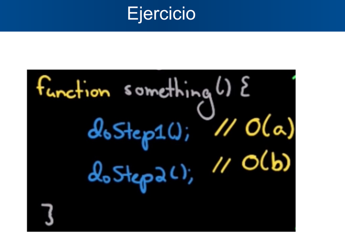

```Java
function something(){   // 0 costo computacional
  doStep1();            // O(paso a)
  doStep2();            // O(paso b)
}
```

Entonces: O(a) + O(b) = O(a + b) = O(1) ya que ambas son sólo llamadas a funciones.

#### Segundo ejemplo

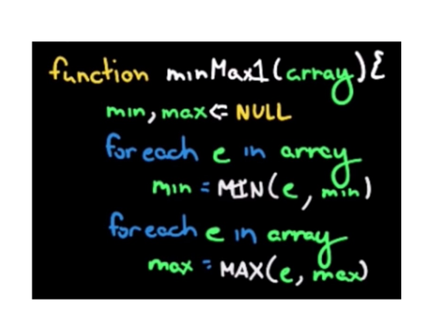

```Java
function minMax1(array){   // 0 costo computacional
  min, max <= NULL

  foreach e in array
    min = MIN(e, min)

  foreach e in array
    max = MAX(e, max)
}
```

En orden de ejecución: O(1) + O(n) + O(n) = O(1) + O(n + n) = O(1) + O(2n) = O(n). O 
si quieres hacer la demostración al 100%: O(1) + O(1) + O(n) + O(1) + O(n) + O(1) = 4*O(1) + 2*O(n) = O(n)

#### Tercer ejemplo

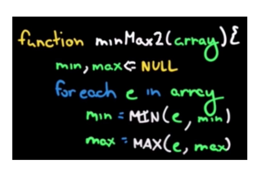

```Java
function minMax2(array){   // 0 costo computacional
  min, max <= NULL

  foreach e in array
    min = MIN(e, min)
    max = MAX(e, max)
}
```

En orden de ejecución: O(1) + O(n) + O(1) + O(1) = 3*O(1) + O(n) = O(n)

#### Cuarto ejercicio

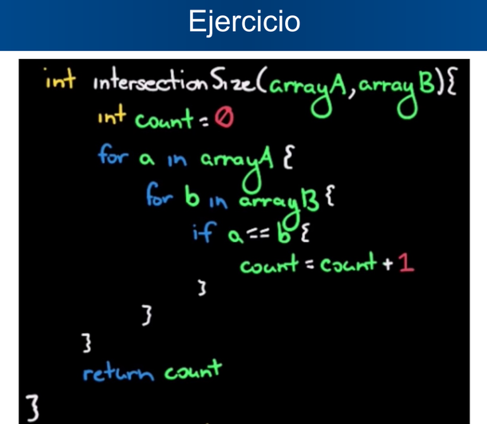

```Java
function intersectionSize(arrayA, arrayB){   // 0 costo computacional
  int count = 0

  for a in arrayA {  // Matriz
    for b in ArrayB {
      if a == b {
        count = count + 1
      }
    }
  }

  return count
}
```

En orden de ejecución: O(1) + [O(n) * O(n)] + O(1) = O(n^2) -> Considerando que ambas
matrices son del mismo tamaño.

Aunque en este curso se dijo que: O(1) + O(n) + O(n) = O(1) + O(2n) = O(n) xD.

#### Quinto ejercicio

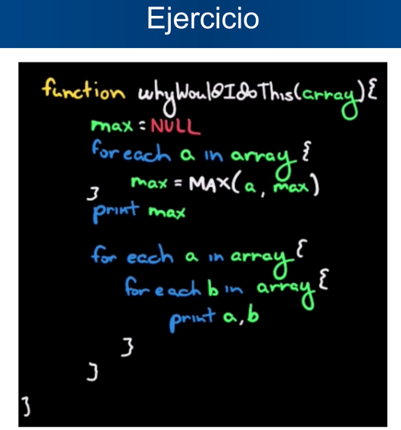

```Java
function whyWouldIDoThis(array){   // 0 costo computacional
  max = NULL

  foreach a in array {
    max = MAX(a, max)
  }

  print max

  foreach a in array {
    foreach b in array {
      print a, b
    }
  }

  return count
}
```

En orden de ejecución: O(1) + O(n) + O(1) + [O(n) * O(n)] + O(1) = 3*O(1) + O(n) + O(n^2) = O(n^2)

### Ejercicio de examen

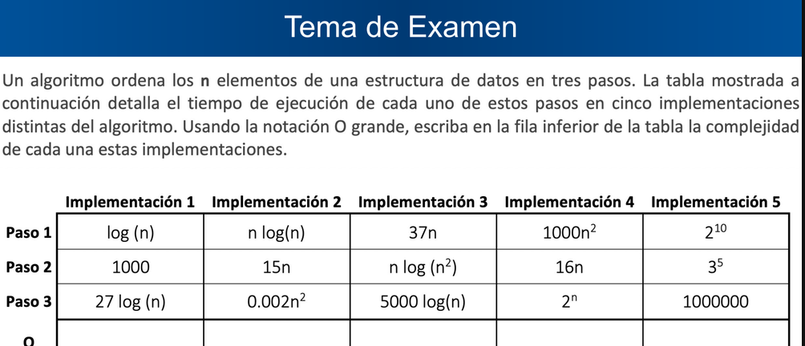

- **Implementación 1**: O(log(n)) + O(1000) + O(27log(n)) = O(log(n)) + O(1000*1) + O(27log(n))
= O(log(n)) + O(1) + O(log(n)) = O(log(n)).

- **Implementación 2**: O(nlog(n)) + O(15n) + O(0.002n^2) = O(nlog(n)) + O(n) + O(n^2) = O(n^2).

- **Implementación 3**: O(37n) + O(nlog(n^2)) + O(5000log(n)) = O(n) + O(2nlog(n)) + O(log(n)) = O(nlog(n))

- **Implementación 4**: O(1000n^2) + O(16n) + O(2^n) = O(n^2) + O(n) + O(2^n) = O(2^n)

- **Implementación 5**: O(2^10) + O(3^5) + O(100000) = O(1)


## Recursividad
Son un tipo particular de funciones / métodos, las cuales, en su cuerpo, se llaman
a sí mismos. 

### Intento de recursividad

Analice el siguiente código:

```Java
public class RecursionExample {
  static void recursiveMethod() {
  System.out.println("Hello");
    recursiveMethod();
  }

  public static void main(String[] args) {
    recursiveMethod();
  }
}
```

El resultado del código adjunto es un programa que imprime "Hello" por siempre. Por lo que
no es óptimo para nada, de hecho, es necesario que estas funciones recursivas tengan
algún tipo de salida.

Si necesitamos una función recursiva es porque se requiere realizar un mismo algoritmo
n veces. Es decir, una cantidad finita de veces. De esta forma, en **toda función/método**
**recursivo**, necesitas un caso base o condición de salida (Cómo saber que el algoritmo llegó a su fin).

Adaptando el mismo algoritmo que retorna un saludo n veces:

```Java
public class RecursionExample {
  static int count = 0;
  static void recursiveMethod() {
    count++;
    if(count<=5){
      System.out.println("Hello " + count);
      recursiveMethod();
    }
  }

  public static void main(String[] args) {
    recursiveMethod();
  }
}
```

### Importancia de la recursividad -> Ok mañana, pero ¿Por qué?

Hay problemas que, por naturaleza, son recursivos. Al momento
que me den un problema en el que se vaya a ejecutar constatemente el mismo 
proceso pensaremos en recursividad. 

#### Factorial
Un buen ejemplo de recursividad es el factorial de un número. De hecho 
fact(n) = {1, si n = 0; n*fact(n-1), si n > 0}. Si lo implementamos en Java:

```Java
public class RecursionExample {
  static int factorial(int n) {
    if (n == 0) {
      return 1; // condición de salida o caso base
    } else {
      return (n * factorial(n-1)); // llamada recursiva
    }
  }

  public static void main(String[] args) {
    System.out.println ("Factorial of 5 is: " + factorial(5));
  }
}
```

#### Sucesión de Fibonacci

Otro ejemplo sería la **sucesión de Fibonacci**. Dicha serie comienza con los números 0 y 1. Cada nuevo
término de la sucesión es la suma de los dos anteriores.

> 0, 1, 1, 2, 3, 5, 8, 13, 21, 34, 55, 89, 144, 233, 377, 610, 987, ...

### Ejemplo 1

```Java
// Suma de los primeros N números
// Calcula la suma de los números desde 1 hasta n usando recursión
public static int suma(int n){
    // Caso base
    if (n == 1) return 1;

    int suma = n + suma(n - 1);

    return suma;
}
```

### Ejemplo 2
```Java
// Contar dígitos de un número 
// Cuenta cuántos dígitos tiene un número entero positivo
public static int contar(int n){
    if (n >= 0){
        // Caso base
        if (n < 10){
            return 1;
        }

        digitos = 1 + contar(n/10);

        return digitos;
    } 
}
```

### Ejemplo 3
```Java
// Invertir un número
// Dado un número xyz -> zyx
public static void mostrarInverso (int n){
    System.out.print(n % 10 + "")

    // Caso base
    if (n < 10){
        return;
    }

    // Paso recursivo
    mostrarInverso(n/10)
}
```

### Ejemplo 4
```Java
// contador de unidades, decenas, centenas, ...
public static void descomponerNumero(int n, int pos){
    if (pos == 0){
        System.out.println(n + "->" );
    }

    // Caso base
    if (n == 0) return;

    String[] unidades = {"unidades", "decenas", "centenas", "millares"};

    // Extraer el último dígito
    int ultimoDigito = n % 10;

    // Llamada recursiva
    descomponerNumero(n / 10, pos + 1);

    System.out.println(ultimoDigito + " " + unidades[pos] + " ");
}
```


## TDAs y estructuras lineales

Hemos visto que los **tipos de datos abstractos** están compuestos de atributos
y comportamientos. Esos comportamientos estarán definidos por valores y cada TDA
tendrá un tipo de operación diferente (Agregar elementos, buscar elementos, eliminar elementos, ...)

En los TDAs usamos el concepto de la abstracción porque nos permite concentrarnos 
en lo escencial (Qué hará el método) para luego concentrarnos en cómo lo implementará.

### Estructuras de datos lineales

Las estructuras de datos lineales son conocidas porque cada elemento va uno detrás de
otro. En este curso, los tipos de datos a emplear serán homogéneos (Si tenemos una lista
de String, todos los elementos serán String también). **Cada elemento en una estructura**
**de datos lineales se conoce como nodo**.

De **acuerdo a su comportamiento**, los conjuntos lineales se clasifican en:

- Listas.

- Pilas.

- Colas.

- Conjuntos y mapas.


### TDA Lista

Es una colección de 0 o más elementos (Podría considerarse al infinito) del cual todos
son del mismo tipo (Datos homogéneos). Son mucho más flexibles que los arreglos porque permiten
trabajo "dinámico" (La estructura puede crecer o achicarse) con un grupo de elementos.

Con una lista, usted puede determinar:

- Crear y Eliminar.

- Conocer si está vacía.

- Añadir elementos y removerlos.

- Consultar el primer y al último elemento.

- Imprimir sus elementos en pantalla.

- Buscar un elemento con cierta infromación en la lista.

En Java la interfaz List corresponde a la implementación del TDA List.

```Java
interface List {
  boolean add(Object o)
  void add(int index, Object element)
  boolean addAll(Collection<? extends Object> c)
  boolean addAll(int index, Collection<? extends Object> c)
  void clear()
  boolean contains(Object o)
  boolean containsAll(Collection<?> c)
  boolean equals(Object o)
  Object get(int index)
  ...
}
```

Recuerde: El TDA especifica el comportamiento pero no la implementación.

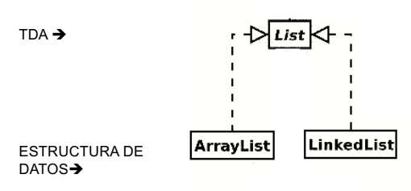

Siga la siguiente implementación de List pero con parámetros de tipo (En este curso):

```Java
public interface List<E> {
  public boolean addFirst(E e); //Inserta el elemento e al inicio

  public boolean addLast(E e); //Inserta el elemento e al final

  public E removeFirst(); //remueve el elemento al inicio de la lista

  public E removeLast(); // remueve el elemento al final de la lista

  public int size();

  public boolean isEmpty();

  public void clear();

  public boolean add(int index, E element); //Inserta el elemento en la posicion index

  public E remove(int index); // remueve y retorna el elemento en la posicion index

  public E get(int index); //retorna el elemento ubicado en la posicion index

  public E set(int index, E element); //setea elemento en la posicion index
}
```

A nivel teórico vamos a tener la clase List, pero para implementaciones concretas usaremos
la clase ArrayList (Implementar la lista de forma estática usando arreglos). Posteriormente
usaremos LinkedList (Implementar la lista de forma dinámica usando nodos). Así, podremos:

```Java
List a = new ArrayList();
List b = new LinkedList();
```

Todo esto referente a la implementación de List con parámetros de tipo. Implementación usada
en este curso.

#### Tipos de Listas

Las listas se pueden clasificar en:

- **Lista simplemente enlazada**

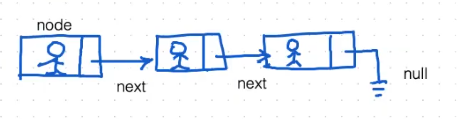

El lugar del que parten las flechas se lo conoce como **puntero next**. El **primer nodo**
es conocido como **head** (cabecera), el último nodo es conocido como **last**. Mientras que
el último puntero se conoce como **puntero a null o nulo** (O apunta a nulo).

- **Lista doblemente enlazada**

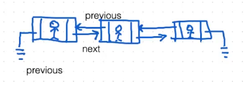

Existen 2 punteros: **previous** y **next**. Ambos nodos finales apuntan a nulo.

- **Lista circular simplemente enlazada**

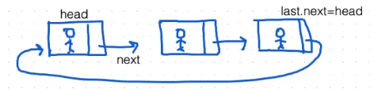

El último puntero apunta o tiene referencia hacia head.

- **Lista circular doblemente enlazada**

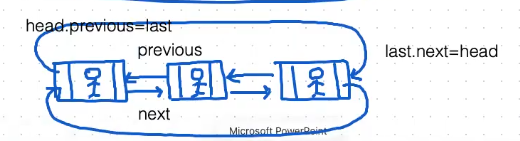


Ahora ya tenemos claro el concepto de lo que debe ser una lista. Hay varias posibilidades 
de implementación para darle vida:

- **Estática o continua**: Usando arreglos de longitud variable (Arraylist en Java). Si nos pidieran entonces
implementar una lista tal que su tamaño sea flexible y pueda manejar posiciones, entonces optamos por usar 
dichos arreglos.

- **Dinámica**: implementación dinámica con nodos (LinkedList en Java).

### Implementación estática de arreglos con ArrayList

En este curso, procederemos a crear nuestra propia implementación de Listas mediante arreglos
con ArrayList.
Vamos a utilizar un arreglo para implementar la interface List. Recordando que los arreglos son una 
secuencia de elementos (No usan nodos) continuos y adyacentes en memoria tales que cada elemento tiene
un índice.

Dado que se puede acceder directamente a una ubicación en particular mediante
el índice del arreglo, el tiempo de acceso es contante (O(1)). Al insertar o remover un elemento
todos los elementos restantes avanzarán o retrocederán

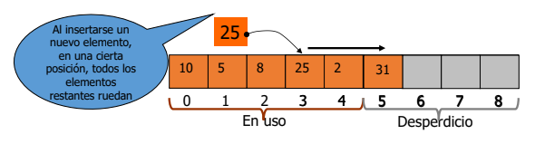

Del arreglo note que: su tamaño total o **capacity = 9** pero solo **se han usado 6 espacios**. En el peor
de los casos, al insertar elementos debemos solucionar situaciones en la que los elementos usado del arreglo
sean superior que la capacidad; al añadir al inicio o al final, tendremos una complejidad **O(n)**. Considere 
también el peor de los casos referente a la inserción de un elemento en un índice en específico -> **O(1)** (Es sólo 
reemplazar).

Para una implementación más concreta, recuerde que el tamaño del arreglo es fijo. Además:

- Si desea insertar un nuevo elemento:
  * Crear un arreglo de tamaño igual al original más 1.
  * Copiar el valor a ser insertado en la primera posición.
  * Copiar los valores del arreglo original dentro de las posiciones restantes del nuevo arreglo.


La implementación de ArrayList en este curso fue la siguiente:

```Java
public class ArrayList<E> implements List<E> {
    // Arreglo de elementos genéricos
    private E[] elements = null;
    
    // Definir capacidad y tamaño efectivo
    private int capacity = 100;
    private int effectiveSize;
    
    public ArrayList(){
        // int[] a;
        
        // a = new int[100];

        // int[] a = new int[100];
        
        elements = (E[]) (new Object[capacity]); // única excepción casting
        
        effectiveSize = 0;
    }

    private void addCapacity(){
        // Crear arreglo temporal con otra capacidad
        E[] tmp = (E[]) new Object[capacity * 2]; // Política de aumento: el doble en ED
        
        // Copiar los primeros 100 elementos al arreglo temporal
        for (int i = 0; i < capacity; i++){
            tmp[i] = elements[i];
        }
        
        // Reemplazar el arreglo viejo
        elements = tmp;
        
        // Actualizar la capacidad en caso de que se llene la memoria
        capacity *= 2;
    }

    @Override
    public boolean isEmpty(){
        return effectiveSize == 0;
    }

    private boolean isFull(){
        return effectiveSize == capacity;
    }
    
    @Override
    public boolean addFirst(E e){ 
        if (e == null){
            return false;
        }
        else if (this.isEmpty()) {
            elements[effectiveSize] = e;
            effectiveSize++;
            return true;
        }

        // Si arreglo está lleno
        else if (isFull()){
            addCapacity();
        }
        
        // Desplazar
        for (int i = effectiveSize - 1; i >= 0; i--){
            elements[i+1] = elements[i]; // Siguiente = Anterior (Bit shifting)
        }
        
        // Insertar elemento en la posición 0
        elements[0] = e;
        effectiveSize++;
        return true;
    }
    
    @Override
    public boolean addLast(E e){
        if (e == null){
            return false;
        }
        if (isFull()){
            addCapacity();
        }
        
        elements[effectiveSize] = e;
        effectiveSize++;
        
        // o también: elements[effectiveSize++] = e;
        return true;
    }
    
    @Override
    public boolean add(int index, E element){ // Añadir por posición del arreglo
        if (index < 0 || index > effectiveSize){ // Fuera de índice
            return false;
        }
        if (isFull()){
            addCapacity();
        }
        // Dejar espacio libre en la posición index
        for (int i = effectiveSize; i > index; i--){
            elements[i] = elements[i - 1];
        }

        // Agregar ese elemento
        elements[index] = element;
        effectiveSize++;
    }
    
    @Override
    public E removeFirst() {
        throw new UnsupportedOperationException("Not supported yet."); // Generated from nbfs://nbhost/SystemFileSystem/Templates/Classes/Code/GeneratedMethodBody
    }

    @Override
    public E removeLast() {
        throw new UnsupportedOperationException("Not supported yet."); // Generated from nbfs://nbhost/SystemFileSystem/Templates/Classes/Code/GeneratedMethodBody
    }

    @Override
    public int size() {
        return effectiveSize;
    }

    @Override
    public void clear() {
        throw new UnsupportedOperationException("Not supported yet."); // Generated from nbfs://nbhost/SystemFileSystem/Templates/Classes/Code/GeneratedMethodBody
    }

    @Override
    public E remove(int index) {
        throw new UnsupportedOperationException("Not supported yet."); // Generated from nbfs://nbhost/SystemFileSystem/Templates/Classes/Code/GeneratedMethodBody
    }

    @Override
    public E get(int index) {
        throw new UnsupportedOperationException("Not supported yet."); // Generated from nbfs://nbhost/SystemFileSystem/Templates/Classes/Code/GeneratedMethodBody
    }

    @Override
    public E set(int index, E element) {
        throw new UnsupportedOperationException("Not supported yet."); // Generated from nbfs://nbhost/SystemFileSystem/Templates/Classes/Code/GeneratedMethodBody
    }
}
```

Es evidente que ArrayList no es eficiente para insertar elementos.

### Implementación continua de arreglos con LinkedList

#### Lista simplemente enlazada

En este curso, también procederemos a crear nuestra propia implementación de Listas mediante nodos
con LinkedList.
Vamos a utilizar linkedList para implementar la interface List. Recordando que los nodos son la unidad
básica o contenedores de una lista enlazada. Es un objeto en memoria que guarda:

- El dato o contenido real.

- La referencia hacia el siguiente puntero.

Se trata de una implementación flexible y potente. Los nodos ya son son adyacentes en memoria (Un nodo A
logra un enlace con otro B, almacenando dentro la dirección de B). Al insertar, en lugar de mover
toda la estructura (como el ArrayList), simplemente hay que enlazar el nuevo elemento a la lista.

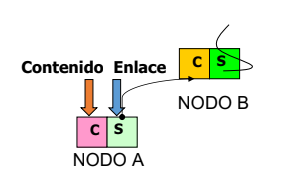

A nivel de implementación:

- Necesitamos llevar control de las posiciones del primer y el último elemento.

- Las posiciones son sólo direcciones en memoria (Referencias).

- La posición de un nodo estará dada por una referencia a dicho nodo.

- Una lista enlazada no tiene datos predefinidos.

La implementación de NodeList y LinkedList en este curso es la siguiente:

```Java
class NodeList<E> {
    private E content;
    private NodeList<E> next;

    public NodeList(E content) {
        this.content = content;
        this.next = null;
    }

    public E getContent() {
        return content;
    }

    public void setContent(E content) {
        this.content = content;
    }

    public NodeList<E> getNext() {
        return next;
    }

    public void setNext(NodeList<E> next) {
        this.next = next;
    }
}
```

```Java
public class LinkedList<E> implements List<E>{
    private NodeList<E> header; // nodo header
    private NodeList<E> last;   // nodo last
    //private int size = 0;
    
    public LinkedList(){
        this.header=null;
        this.last=null;
    }

    public NodeList<E> getHeader() {
        return header;
    }

    public void setHeader(NodeList<E> header) {
        this.header = header;
    }

    public NodeList<E> getLast() {
        return last;
    }

    public void setLast(NodeList<E> last) {
        this.last = last;
    }

    @Override
    public boolean addFirst(E e) { // Dado un elemento generico
        //size++;
        if(e!=null) {
            NodeList<E> newNode = new NodeList<>(e); // constructor crea un nodo aislado
            // Box<Integer> newBox = new Box<>(1000);
            // Class<TYPE> newClass = new Class<TYPE>(value);

            newNode.setNext(header); // El siguiente de ese nuevo nodo es Header
            this.setHeader(newNode); // Actualizar el header de la lista

            // Por si es la primera vez insertando
            if (last == null) {
                last = newNode;
            }

            return true;
        } else {
            return false;
        }
    }

    @Override
    public boolean addLast(E e) {
        //size++;
        if(e!=null){
            NodeList<E> newNode = new NodeList<>(e);

            if(last !=null){
                last.setNext(newNode);
            }

            last=newNode;
            
            if(header == null){
                header = newNode;
            }
            return true;
        } else {
            return false;
        }  
    }
    
    // OJO
    private NodeList<E> getPrevious(NodeList<E> node){
        NodeList<E> previous = null;
        NodeList<E> n;
        
        for(n = header; n!=node; n= n.getNext()){
            previous = n;
        }
        return previous;
    }
    
    private void recorrerHaciAtras(){
        NodeList<E> n;
        
        for (n = last; n != header; n = this.getPrevious(n)){
            System.out.println(n);
        }
    }
    
    @Override
    public E removeFirst() {
        //size--;
        if (header == null){
            return null;
        }

        // Guardando el header
        NodeList<E> n = header;
        E content = header.getContent();

        // El nuevo header es el segundo nodo
        setHeader(n.getNext());

        // el anterior header ahora apunta a null
        n.setNext(null);


        // Si la lista queda vacía
        if (header == null){
            last = null;
        }

        return content;
    }

    @Override
    public E removeLast() {
        // Lista vacía
        if (header == null) {
            return null; 
        }
        
        E content = last.getContent();
        
        // Si solo hay un elemento
        if (header == last) {
            header = null;
            last = null;
            return content;
        }
        
        // Si hay más de un elemento, usamos getPrevious()
        NodeList<E> previous = getPrevious(last);
        previous.setNext(null); // rompemos conexiones del último nodo
        last = previous;        // Actualizamos el puntero last
        
        return content;
    }

    @Override
    public int size() {
        // return size; // O(1)
        // primera parte declaro variables a iterar
        // segunda parte condicion logica
        // tercera parte instrucciones
        //for (int i=0, j=0; i < 10 && j >8; i++){
        //for (NodeList<E> n = header; n ! = null ; n = n.getNext()){
        
        // Complejidad lineal O(n) a pesar de que no es tan buena como O(1) evita que tenga que darle mantenimiento a size
        int size = 0;
        NodeList<E> n; //declaro un nodo viajero
        //declaro un nodo viajero, mientras sea diferente de null, se mueve al siguiente nodo
        
        for (n = header ; n!= null ; n = n.getNext()) {
            size++;
        }
        return size;
    }

    @Override
    public boolean isEmpty() {
        return header == null;
    }

    @Override
    public void clear() {
        header = null;
        last = null;
    }

    @Override
    public boolean add(int index, E e) {
        // Validaciones
        if (index < 0 || e == null) return false;
        
        // Insertar al principio
        if (index == 0) {
            return addFirst(e);
        }
        
        // Buscamos el nodo anterior a la posición donde queremos insertar
        NodeList<E> current = header;

        // No podemos usar getPrevious porque no conocemos el nodo
        for (int i = 0; i < index - 1; i++) {
            // Índice fuera de límites
            if (current == null) return false;

            current = current.getNext();
        }

        // Evitar errores
        if (current == null) return false;
        
        // Caso: Insertar después del último
        if (current == last) {
            return addLast(e);
        }

        // Inserción en el medio
        NodeList<E> newNode = new NodeList<>(e);
        newNode.setNext(current.getNext());
        current.setNext(newNode);
        return true;
    }

    @Override
    public E remove(int index) {
        // Validaciones
        if (index < 0 || header == null) return null;
        
        // Remover el primero
        if (index == 0) {
            return removeFirst();
        }
        
        NodeList<E> current = header;
        NodeList<E> prev = null;
        
        // Buscando nodo a eliminar y su anterior
        for (int i = 0; i < index; i++) {
            prev = current;
            current = current.getNext();
            
            // Índice fuera de límites
            if (current == null) return null; 
        }
        
        // Caso: Remover el último
        if (current == last) {
            return removeLast();
        }
        
        // Remover en el medio: el anterior ahora apunta al siguiente del actual
        prev.setNext(current.getNext());
        
        // Actual (eliminado) ahora apunta a nulo
        current.setNext(null);
        
        return current.getContent();
    }

    @Override
    public E get(int index) {
        // Validaciones
        if (index < 0 || header == null) return null;
        
        NodeList<E> current = header;
        for (int i = 0; i < index; i++) {
            current = current.getNext();

            if (current == null) return null; // El índice era mayor al tamaño
        }

        return current.getContent();
    }

    @Override
    public E set(int index, E element) {
        // Validaciones
        if (index < 0 || element == null || header == null) return null;
        
        NodeList<E> current = header;

        for (int i = 0; i < index; i++) {
            current = current.getNext();

            // índice fuera de rango (Como en get())
            if (current == null) return null; 
        }
        
        E oldContent = current.getContent();
        current.setContent(element); // Pisamos el dato viejo
        return oldContent;           // Retornamos el que estaba antes
    }
    
    public Iterator<E> iterator(){
        Iterator<E> it=new Iterator<E>() {
                NodeList<E> cursor = header;
                
            @Override
            public boolean hasNext() {
                return cursor != null;
            }

            @Override
            public E next() {
                E e = cursor.getContent();
                cursor = cursor.getNext();
                return e;
            }
        };
        
        
        return it;
    }
    
    // Ejercicios del taller
    // 1. Método para dividir los lanzamientos de Yahtzee
    public static LinkedList<Integer>[] dividirLanzamientos(List<Integer> lista) {
        // Creamos el arreglo estático de tamaño 3 para los jugadores
        LinkedList<Integer>[] resultado = new LinkedList[3];
        
        // Inicializamos cada posición del arreglo con una nueva LinkedList
        for (int i = 0; i < 3; i++) {
            resultado[i] = new LinkedList<Integer>();
        }
        
        int turno = 0; // 0 = Jugador 1, 1 = Jugador 2, 2 = Jugador 3
        
        // Recorremos la lista usando un foreach
        for (Integer lanzamiento : lista) {
            // addLast --> O(1)
            resultado[turno].addLast(lanzamiento); 
            
            // La clave del ejercicio es avanzar la variable turno
            // Avanzamos el turno usando aritmética modular (0, 1, 2, 0, 1, 2...)
            turno = (turno + 1) % 3;
        }
        
        return resultado;
    }
    // De dividirLanzamientos se puede evidenciar una complejidad O(n). No contamos
    // con complejidad cuadrática ya que no tenemos for anidados.


    // 2. Método para obtener el historial de pedidos de un cliente
    public static List<String> getPedidosPorCliente(List<Pedido> listaPedidos, String cliente) {
        // Lista de pedidos general por retornar
        LinkedList<String> historialProductos = new LinkedList<>();
        
        // Validaciones
        if (listaPedidos == null || cliente == null) {
            // Lista vacia 
            return historialProductos;
        }

        // Recorremos listaPedidos con un foreach
        for (Pedido pedido : listaPedidos) {
            // Verificamos si este pedido le pertenece al cliente que buscamos
            // En Java equals() compara directamente el contenido (no el puntero)
            if (cliente.equals(pedido.getCliente())) {
                // Sacamos la lista de productos de este pedido en particular
                List<String> productosDelPedido = pedido.getProductos();
                
                // Recorremos los productos y los agregamos al historial general
                if (productosDelPedido != null) {
                    for (String producto : productosDelPedido) {
                        historialProductos.addLast(producto);
                    }
                }
            }
        }
        
        return historialProductos;
    }
    // Por cierto, la complejidad de getPedidosPorCliente es O(n^2)


    // 3. Método para comparar carteras de inversión y sumar menores
    public static LinkedList<Integer> sumarMenores(LinkedList<Integer> listaA, LinkedList<Integer> listaB) {
        LinkedList<Integer> resultado = new LinkedList<>();
        
        // Validaciones
        if (listaA == null || listaB == null) {
            return resultado;
        }

        // Iteramos con foreach la lista A
        for (Integer umbral : listaA) {
            int suma = 0;

            // Verificamos con CADA valor de B
            for (Integer valorB : listaB) {
                // Identificar transacciones menor a "umbral"
                if (valorB != null && valorB < umbral) {
                    suma += valorB;
                }
            }
            
            // Añadimos
            resultado.addLast(suma);
        }

        return resultado;
    }
    // Este método implica una complejidad de O(n^2)


    // 4. Método principal para IoT (IoT)
    public static List<String> getStringsShorterThan(List<String> inputList, int k) {
        LinkedList<String> resultado = new LinkedList<>();
        
        // Validación
        if (inputList == null && k > 0) {
            return resultado;
        }
        
        // Casting
        LinkedList<String> miLista = (LinkedList<String>) inputList;

        // Método recursivo
        filtrarRecursivo(miLista.getHeader(), k, resultado);
        
        return resultado;
    }

    private static void filtrarRecursivo(NodeList<String> actual, int k, LinkedList<String> resultado) {
        // Caso de salida o base: Si el nodo es null, llegamos al final de la lista
        if (actual == null) {
            return;
        }
        
        // Procesamos el nodo en el que estamos parados
        String texto = actual.getContent();
        
        // Si el texto cumple la condición, lo metemos a la lista resultado
        if (texto != null && texto.length() < k) {
            resultado.addLast(texto);
        }
        
        // Recursión: lo mismo pero con el siguiente nodo
        filtrarRecursivo(actual.getNext(), k, resultado);
    }

    @Override
    public String toString() {
        if (header == null) return "";

        String s="";
        for (NodeList<E> n=header; n!=null; n=n.getNext()) {
            s+=n.getContent();

            if (n.getNext() != null) {
                s += ", ";
            }
        }
        return s;
    }
}
```

#### Lista doblemente enlazada

En las listas simplemente enlazadas nosotros podemos avanzar en un sólo sentido. En las doblemente, 
se puede avanzar hacia la derecha o la izquierda. En estas listas cada nodo tiene:

- Un predecesor, excepto el primero.

- Un sucesor, excepto el último.

Es decir, cada nodo ya no tiene un sólo enlace, tiene dos, hacia el siguiente (next) y
hacia el anterior (previous).


Al querer acceder a un elemento en este tipo de listas, en el peor de los casos, sería
una complejidad de O(n/2) = O(n). Por otro lado, insertar al final o al inicio O(1).


Al querer insertar nodos (First pos y Last pos), es exactamente el mismo algoritmo anterior 
sólo que ahora debemos asignar 2 nodos (Next y previous).


Ahora, para insertar entre en la lista, nuevamente necesitamos establecer 2 conexiones; nodo
previous y nodo next.

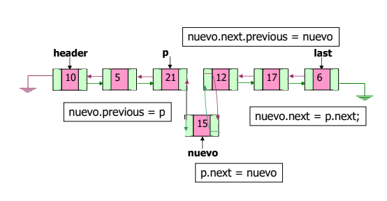

Para eliminar nodos, simplemente debemos remover las conexiones del nodo que queremos
eliminar y restablecer las conexiones para que no hayan nodos sin conexiones.

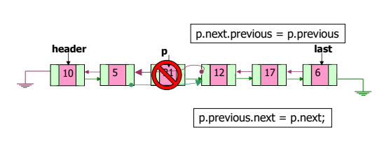

En este curso, la implementación de la lista doblemente enlazada y su respectivo nodo:

```Java
public class DoublyNodeList<E> {
    private E content;
    private DoublyNodeList<E> next;     // Un next
    private DoublyNodeList<E> previous; // Un previous
    
    public DoublyNodeList(E content){
        this.content = content;
        this.next = null;
        this.previous=null;
    }
    
    public E getContent() {
        return content;
    }

    public void setContent(E content) {
        this.content = content;
    }

    public DoublyNodeList<E> getNext() {
        return next;
    }

    public void setNext(DoublyNodeList<E> next) {
        this.next = next;
    }

    public boolean getPrevious(DoublyNodeList<E> node){
        return previous;
    }

    public void setPrevious(DoublyNodeList<E> previous) {
        this.previous = previous;
    }
    
}
```

```Java
public class DoublyLinkedList<E> implements List<E> {
    
    private DoublyNodeList<E> header;
    private DoublyNodeList<E> last;
    
    public DoublyLinkedList(){
        this.header = null;
        this.last = null;
    }

    public boolean isEmpty(){
        return header == null && last == null;
    }
    
    public int size() {
        throw new UnsupportedOperationException("Not supported yet.");
    }
    
    public DoublyNodeList<E> getHeader() {
        return header;
    }

    public void setHeader(DoublyNodeList<E> header) {
        this.header = header;
    }

    public DoublyNodeList<E> getLast() {
        return last;
    }

    public void setLast(DoublyNodeList<E> last) {
        this.last = last;
    }
    
    public void getPrevious(NodeList<E> node){
        return previous;
    }
   
    private void recorrerHaciaAtras(){
        DoublyNodeList<E> n;
        for (n = last ; n != header; n = n.getPrevious()){
            // System.Out.println(n);
        }
    }
    
    public boolean addFirst(E e)
    {
        if (e != null){
            // Nodo a insertar
            DoublyNodeList<E> newNode = new DoublyNodeList<>(e);
            newNode.setNext(header);
            header.setPrevious(newNode);
            this.setHeader(newNode);
            return true;
        }
        return false;
    }
    
    public boolean addLast(E e)
    {
        if (e != null){
            DoublyNodeList<E> newNode = new DoublyNodeList<>(e);
            newNode.setPrevious(last);
            last.setNext(newNode);
            this.setLast(newNode);
            return true;
        }
        return false;
    }
    
    public boolean addAt(E e, int pos)
    {
        if (e != null && pos >= 0 && pos < this.size()) {
            DoublyNodeList<E> newNode = new DoublyNodeList<>(e);
            
            DoublyNodeList<E> p = header;
            
            for(int i=0; i < pos ; i ++){
                p = p.getNext();
            }
            newNode.setNext(p.getNext());
            p.setNext(newNode);
            
            newNode.setPrevious(p);
            newNode.getNext().setPrevious(newNode);
           
        }
        return false;
    }
    
    public E removeElement (int pos){
        DoublyNodeList<E> p = header;
        
        for(int i=0; i < pos; i++){
            p = p.getNext();
        }
        
        p.getPrevious().setNext(p.getNext());
        p.getNext().setPrevious(p.getPrevious());
        
        p.setNext(null);
        p.setPrevious(null);
        
        return p.getContent();
        }

    @Override
    public E removeFirst() {
        throw new UnsupportedOperationException("Not supported yet."); // Generated from nbfs://nbhost/SystemFileSystem/Templates/Classes/Code/GeneratedMethodBody
    }

    @Override
    public E removeLast() {
        throw new UnsupportedOperationException("Not supported yet."); // Generated from nbfs://nbhost/SystemFileSystem/Templates/Classes/Code/GeneratedMethodBody
    }

    @Override
    public void clear() {
        throw new UnsupportedOperationException("Not supported yet."); // Generated from nbfs://nbhost/SystemFileSystem/Templates/Classes/Code/GeneratedMethodBody
    }

    @Override
    public void add(int index, E element) {
        throw new UnsupportedOperationException("Not supported yet."); // Generated from nbfs://nbhost/SystemFileSystem/Templates/Classes/Code/GeneratedMethodBody
    }

    @Override
    public E remove(int index) {
        throw new UnsupportedOperationException("Not supported yet."); // Generated from nbfs://nbhost/SystemFileSystem/Templates/Classes/Code/GeneratedMethodBody
    }

    @Override
    public E get(int index) {
        throw new UnsupportedOperationException("Not supported yet."); // Generated from nbfs://nbhost/SystemFileSystem/Templates/Classes/Code/GeneratedMethodBody
    }

    @Override
    public E set(int index, E element) {
        throw new UnsupportedOperationException("Not supported yet."); // Generated from nbfs://nbhost/SystemFileSystem/Templates/Classes/Code/GeneratedMethodBody
    }
}
```

#### Lista circular simplemente enlazada

Hasta ahora hemos visto un avance en las listas sólo a la derecha (siguiente) y,
de cierta forma, limitadas hasta su último nodo Last. Existen ocasiones en las que no 
sólo queremos implementar listas de esa forma sino que, por ejemplo, se pueda avanzar
ilimitadamente, es decir, del último nodo pasar al primero.


Así, no es necesario mantener un control de primero y del último. Solo con el último
ya se tiene todo, pues el siguiente al último es el primero.

Todo nodo válido, apenas esté creado debe apuntar a sí mismo en una lista circular 
simplemente enlazada.

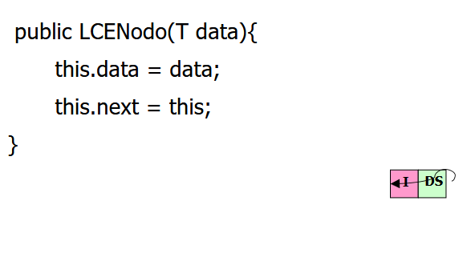

En el caso de que se requitera inserción al inicio y al final de la lista, la
idea es la siguiente:

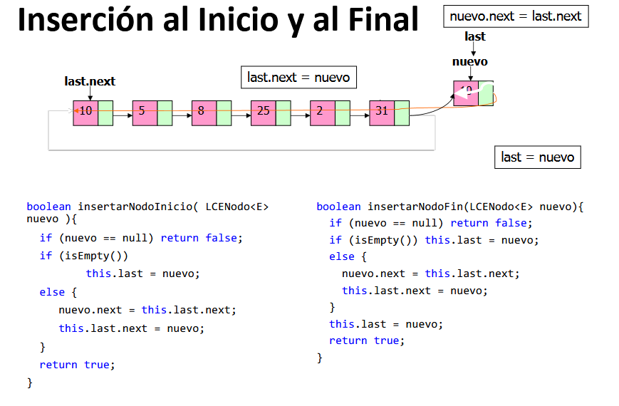

La implementación a seguir en este curso de CircularNodeList y CircularLinkedList:

```Java
public class CircularNodeList<E> {
    private E content;
    private CircularNodeList<E> next;
    
    public CircularNodeList(E content){
        this.content=content;
        this.next=this; // Instancia de un nodo el next ya no apunta a null sino a si mismo
    }
    
    public E getContent(){
        return content;
    }
    
    public void setContent(E content){
        this.content = content;
    }
    
    public CircularNodeList<E> getNext(){
        return next;
    }
    
    public void setNext(CircularNodeList<E> next){
        this.next = next;
    }
}
```

```Java
public class CircularLinkedList<E> implements List<E> {
    
    private CircularNodeList<E> last;
    
    public CircularNodeList<E> getLast(){
        return last;
    }
    
     public CircularNodeList<E> getHeader(){
        return last.getNext();
    }
    
    public void setLast(CircularNodeList<E> last){
        this.last = last;
    }
    
    @Override
    public boolean addFirst(E e) {
        throw new UnsupportedOperationException("Not supported yet."); // Generated from nbfs://nbhost/SystemFileSystem/Templates/Classes/Code/GeneratedMethodBody
    }

    @Override
    public boolean addLast(E e) {
        throw new UnsupportedOperationException("Not supported yet."); // Generated from nbfs://nbhost/SystemFileSystem/Templates/Classes/Code/GeneratedMethodBody
    }

    @Override
    public E removeFirst() {
        throw new UnsupportedOperationException("Not supported yet."); // Generated from nbfs://nbhost/SystemFileSystem/Templates/Classes/Code/GeneratedMethodBody
    }

    @Override
    public E removeLast() {
        throw new UnsupportedOperationException("Not supported yet."); // Generated from nbfs://nbhost/SystemFileSystem/Templates/Classes/Code/GeneratedMethodBody
    }

    @Override
    public int size() {
        throw new UnsupportedOperationException("Not supported yet."); // Generated from nbfs://nbhost/SystemFileSystem/Templates/Classes/Code/GeneratedMethodBody
    }

    @Override
    public boolean isEmpty() {
        throw new UnsupportedOperationException("Not supported yet."); // Generated from nbfs://nbhost/SystemFileSystem/Templates/Classes/Code/GeneratedMethodBody
    }

    @Override
    public void clear() {
        throw new UnsupportedOperationException("Not supported yet."); // Generated from nbfs://nbhost/SystemFileSystem/Templates/Classes/Code/GeneratedMethodBody
    }

    @Override
    public void add(int index, E element) {
        throw new UnsupportedOperationException("Not supported yet."); // Generated from nbfs://nbhost/SystemFileSystem/Templates/Classes/Code/GeneratedMethodBody
    }

    @Override
    public E remove(int index) {
        throw new UnsupportedOperationException("Not supported yet."); // Generated from nbfs://nbhost/SystemFileSystem/Templates/Classes/Code/GeneratedMethodBody
    }

    @Override
    public E get(int index) {
        throw new UnsupportedOperationException("Not supported yet."); // Generated from nbfs://nbhost/SystemFileSystem/Templates/Classes/Code/GeneratedMethodBody
    }

    @Override
    public E set(int index, E element) {
        throw new UnsupportedOperationException("Not supported yet."); // Generated from nbfs://nbhost/SystemFileSystem/Templates/Classes/Code/GeneratedMethodBody
    }
   
}
```


## La interfaz Iterable

De los ejemplos anteriores ya hemos visto que para recorrer elementos dentro
de un ArrayList o LinkedList usamos un bucle for. Sin embargo, existen formas más 
eficientes de **iterar en cada elemento**.

Un Iterador es como un puntero laser o un cursor virtual que va recorriendo tus 
datos elemento por elemento. Imagina que tienes una lista y no quieres preocuparte por 
cómo está guardada internamente (si usa arreglos o nodos enlazados). El iterador te 
da una forma universal y segura de decir: "Dame el siguiente elemento hasta que te quedes 
sin datos".

Los iteradores permiten el uso de una versión mejorada de lazo for. A este tipo de lazo
se lo conoce como for-each.

```Java
for (Item item: customDataStructure) {
    // do stuff
}
```

### Ejemplo de una lista ITERABLE

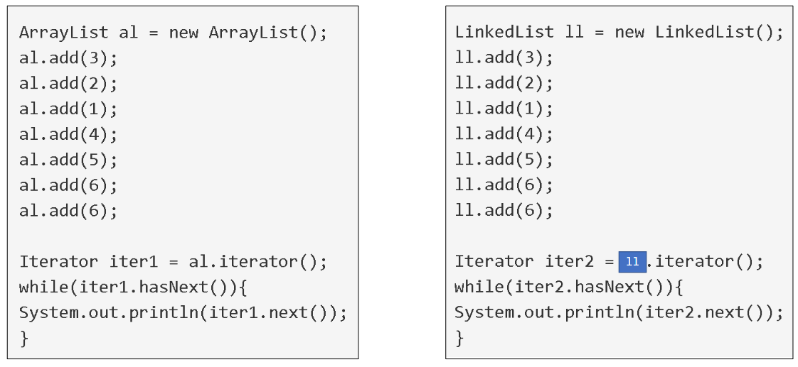

> Note que son diferentes instancias de Iterator. Asi que diferentes listas, diferentes iteradores.


### ¿Cómo implementamos Iterable?

Lo que permite que la Lista se pueda iterar es la **interfaz Iterable** con ayuda de un
**Iterator**. Para implementar la interfaz Iterable en nuestra propia clase:

1. Implementar la interface Iterable (La que me permite iterar en la lista). 

2. Crear una clase que implemente la interface Iterable (Con qué voy a iterar).

Estructura general de la clase contenedora (En la que se va a iterar):

```Java
class CustomDataStructure<E> implements Iterable<E> { // En mi clase se PUEDE iterar
    // Código y atributos de la estructura de datos

    @Override
    public Iterator<E> iterator() {
        return new CustomIterator<E>(this); // Retorna una nueva instancia de un ITERATOR
    }
}
```

Estructura general del iterador personalizado (El iterador):

```Java
class CustomIterator<E> implements Iterator<E> { // Mi clase PUEDE ser un iterador
    
    // Constructor: recibe la estructura y configura el cursor inicial
    CustomIterator(CustomDataStructure<E> obj) {
        // Inicialización del cursor
    }

    @Override
    public boolean hasNext() {
        // Devuelve true si el cursor no ha llegado al final
    }

    @Override
    public E next() {
        // Obtiene el elemento actual y mueve el cursor
    }
}
```

### Las dos interfaces: Iterable vs Iterator

Para entender cómo funciona en Java, hay que diferenciar estos dos conceptos:

- Iterable<E> (El contenedor): Es una interfaz que dice "Mi estructura de datos se puede 
recorrer". Al implementarla, habilitas el uso del famoso bucle for-each.

- Iterator<E> (El control remoto): Es el objeto real que lleva el rastreo de dónde estamos 
parados durante el recorrido.

```
Estructura de Datos (**implementa Iterable**)
       │
       └───> Método iterator() ───> Crea un objeto Iterator (el cursor)
```

#### Los dos métodos de Iterator

Cualquier objeto que sea un Iterator **(Que implemente Iterator)** debe responder dos preguntas fundamentales:

1. `hasNext()`: ¿Aún queda algún elemento más adelante? (Retorna true o false).

2. `next()`: Retorna el elemento actual y avanza el cursor un paso hacia adelante.

Un ejemplo sobre cómo recorrer manualmente una lista con Iterator:

```Java
// miLista implementa 'Iterable', así que TIENE el método .iterator()
Iterator<String> miCursor = miLista.iterator(); // Nace el cursor al inicio

// miCursor es de tipo 'Iterator', así que TIENE .hasNext() y .next()
while (miCursor.hasNext()) {         // 1. ¿Hay siguiente?
    String elemento = miCursor.next(); // 2. Dame el valor y avanza el cursor
    System.out.println(elemento);
}
```

Por detrás, Java convierte este for-each en el bucle while con Iterator del ejemplo
de arriba:

```Java
for (String elemento : miLista) {
    System.out.println(elemento);
}
```

### Iterator<E>

Un Iterator es una abstracción que da acceso a los elementos de una lista sin exponer
su estructura interna (no necesitas manipular nodos ni llamar a métodos internos
como getContent). Se encuentra en el paquete java.util y es una interfaz parametrizada
por tipo (Iterator<E>).

| Método | Tipo de retorno | Función |
| :--- | :--- | :--- |
| `hasNext()` | `boolean` | Revisa si existe un elemento siguiente en la colección antes de avanzar. |
| `next()` | `E` | Devuelve el elemento actual y **avanza el cursor** al siguiente. |
| `remove()` | `void` | *(Opcional)* Elimina el último elemento devuelto. Por defecto lanza `UnsupportedOperationException`. |


### ¿Cómo puedo implementar mi propio .iterator()

Existen 4 reglas del método .iterator():

1. Debe retornar una instancia concreta que **implemente Iterator<E>**.

2. Dicha instancia es la encargada de guardar el estado de la iteración 
(saber en qué índice o nodo va el recorrido).

3. Debe instanciar un nuevo iterador en cada llamada. Nunca debe retornar 
la misma instancia dos veces, de lo contrario se generarían conflictos si existen 
dos bucles ejecutándose al mismo tiempo sobre la misma lista.

Para implementar un Iterador en Java tenemos dos formas principales de escribir 
la lógica del iterador para nuestra propia estructura de datos: 

#### Opción A: Clase Anónima (La más limpia y usada)

Creas la instancia del iterador directamente dentro del método `iterator()`:

```Java
@Override
public Iterator<E> iterator() {
    Iterator<E> it = new Iterator<E>() {
        // Implementación directa de los métodos de la interfaz
        @Override
        public boolean hasNext() { ... }

        @Override
        public E next() { ... }
    };
    return it; 
}
```

#### Opción B: Clase aparte, dedicada que implemente Iterator 

```Java
public class MyIterator<E> implements Iterator<E> {
    // Implementación de hasNext() y next()
}

@Override
public Iterator<E> iterator() {
    return new MyIterator<E>(); // Instanciación directa
}
```

### Ejemplos

Recuerde la implementación de List<T> para este curso. Ahora List va a 
heredar de Iterable (No puede usarse implements porque una interfaz
NO puede implementar otra interfaz):

```Java
package linkedlist;
import java.util.Comparator;

public interface List<E> extends Iterable<E>{ // EXTENDS

    public boolean addFirst(E e); //Inserta el elemento e al inicio
            
    public boolean addLast(E e); //Inserta el elemento e al final
            
    public E removeFirst(); //remueve el elemento al inicio de la lista
    
    public E removeLast(); // remueve el elemento al final de la lista
    
    public int size();
    
    public boolean isEmpty();
    
    public void clear();
            
    public void add(int index, E element); //Inserta el elemento en la posicion index
            
    public E remove(int index); // remueve y retorna el elemento en la posicion index
    
    public E get(int index); //retorna el elemento ubicado en la posicion index
    
    public E set(int index, E element); //setea elemento en la posicion index

    public List<E> findIntersection(List<E> another); // Note esta función (COMPARATOR)
    
    // public List<E> findIntersection(List<E> another, Comparator<E> cmp); // <---
    
}
```

Ahora, en ArrayList, procedemos a reescribir el método iterator() de la 
siguiente forma:

```Java
@Override
public Iterator<E> iterator(){
    Iterator<E> it=new Iterator<E>() {
        int cursor = 0;

        @Override
        public boolean hasNext() {
            return cursor < effectiveSize;
        }

        @Override
        public E next() {
            E e=elements[cursor];
            cursor++;
            return e;
        }
    };
    return it;   
}
```

En un Main de prueba tendríamos:

```Java
    List<Integer> l1= new ArrayList<>();
    l1.addFirst(0);
    l1.addFirst(1);
    l1.addFirst(2);
    l1.addFirst(3);

    List<Integer> list= new ArrayList<>();
    list.addLast(1);
    list.addLast(2);
    list.addLast(3);
    list.addLast(4);

    Iterator<Integer> it = l1.iterator();

    //Equivalencias
    for (Integer n : list){
        System.out.println(n);
    }
        
    while(it.hasNext()){
        Integer n = it.next();
        System.out.println(n);
    }

// Output
// 1
// 2
// 3
// 4
// 
// 3
// 2
// 1
// 0
```

También lo podemos implementar con LinkedList. En LinkedList, reescribimos
el método .iterator():

```Java
@Override
public Iterator<E> iterator(){
    Iterator<E> it = new Iterator<E>() {
            NodeList<E> cursor = header;
                
        @Override
        public boolean hasNext() {
            return cursor != null;
        }

        @Override
        public E next() {
            E e = cursor.getContent();
            cursor = cursor.getNext();
            return e;
        }
    };
    return it;
}   
```

En nuestro Main tendríamos ahora:

```Java
    List<Integer> listaDinamica = new LinkedList<>();
    listaDinamica.addLast(1);
    listaDinamica.addLast(0);
    listaDinamica.addLast(1);

    Iterator<Integer> miIterador = listaDinamica.iterator();

    while (miIterador.hasNext()) {
        Integer n = miIterador.next();
        System.out.println(n);
    }
```

## La interfaz Comparator<E>

### El problema de los operadores relacionales

Si en Java tienes 2 enteros `int a = 5` y `int b = 10`, saber cuál es el mayor
o si son iguales es trivial, basta con `a > b` o `a == b`.

Pero, ¿qué pasa cuando tienes objetos complejos como `Estudiante`, `Producto` o `Customer`?
Si tienes dos clientes (customers) c1 y c2, Java no tiene idea de cómo compararlos.

- ¿Los compara por su nombre?

- ¿Por su edad?

- ¿Por su promedio?

- ¿Por la ciudad donde viven?

Para darle a Java instrucciones exactas de cómo medir u ordendar objetos personalizados
existe la interfaz `Comparator<E>`.

### Ejercicio 

Antes de seguir explicando la interfaz Comparator, revise el siguiente ejercicio. Recuerde
que en la clase List habíamos dejado un método con la firma:

```Java
public List<E> findIntersection(List<E> another);
```

Dicho método recibe una lista y retorna los elementos communes a la lista recibida y
a la que invoca el método.

Entonces, en la clase LinkedList:

```Java
public List<E> findIntersection(List<E> another){
    List<E> resultado = new LinkedList<>();

    for (E e: this){ // Internamente se ejecuta nuestro .iterator(), obteniendo .getContent()
        for (E otherListElement : another){
            if (e == otherListElement) resultado.addLast(e);
        }
    }

    return resultado;
}
```

Si hacemos instancias de prueba:

```Java
List<Integer> l1= new LinkedList<>();
l1.addFirst(1);
l1.addFirst(2);
l1.addFirst(3);
l1.addFirst(0);
        
List<Integer> l2= new LinkedList<>();
list.addLast(1);
list.addLast(2);
list.addLast(3);
list.addLast(4);

List<Integer> resultado = l1.findIntersection(l2);
// Salida
// 1
// 2
// 3
```

Sin embargo, ¿qué sucediera si quisieramos comparar objetos?. Note lo siguiente:

```Java
List<Person> list3 = new LinkedList<>();
list3.addLast(new Person("Raquel", "Jaramillo", 24));
list3.addLast(new Person("Raquel", "Jaramillo", 28));
list3.addLast(new Person("Raquel", "Jaramillo", 47));
list3.addLast(new Person("Rafael", "Pesantez", 23));
list3.addLast(new Person("Felix", "Prado", 38));

List<Person> list4 = new LinkedList<>();
list4.addLast(new Person("Raquel", "Jaramillo", 24));
list4.addLast(new Person("Felix", "Prado", 38));
list4.addLast(new Person("Emilio", "Doumet", 17));
list4.addLast(new Person("Alex", "Vaca", 84));
list4.addLast(new Person("Daniel", "Pesantez", 23));
        
        
List<Person> intersection2 = list3.findIntersection(list4);
for (Person p : intersection2) {
    System.out.println(p);
}
        
List<Person> intersection3 = list3.findIntersection(list4);
for (Person p : intersection3) {
    System.out.println(p);
}
// Salida
// ...
```

El operador relacional `==` no es suficiente para comparar objetos (Aunque se podría usar .equals()).
Más adelante veremos cómo hacer el mismo método **con un Comparador**.

### Continuando con la Interfaz Comparator<E>

Al implementar (implements) la interfaz `Comparator<E>`, se exige reescribir el único
método principal con firma:

```Java
int compare(T object1, T object2)
```

Como se puede evidenciar, Este método siempre retorna un número entero (int) y sigue 
una convención universal de tres estados:


> TIP: Si solo te interesa saber si son iguales (para un método de búsqueda como findAll o contains), que retorne 0 cuando coincidan y cualquier otro número (como 1 o -1) cuando sean distintos.

No es necesario que sea sólo 0, 1, o -1. Podría darse el caso que esté comparando edades, en ese caso
si la edad 1 es mayor que la edad 2 (10 > 5), podría retornar `return 10 - 5` que ya retorna un número
positivo.

#### Para qué nos sive en los TDAs

Suponga que en LinkedList<E> se quiere crear un método genérico para buscar elementos que 
cumplan cierto criterio:

```Java
LinkedList<E> findAll(Comparator<E> cmp, E object)
``` 

La lista no necesita saber si está guardando autos, personas o perros. La lista 
simplemente recorre sus nodos y en cada paso le pregunta al comparador:

```Java
if (cmp.compare(nodoActual.getContent(), object) == 0) {
    // ¡Coinciden en el criterio! Lo agregamos a la lista de resultados[cite: 50, 52]
}
```

### Formas de Implementar un Comparator

#### Creando una Instancia de la clase Comparator

Crear la instancia del comparador, guardarla en una variable y luego pasarla a un método:

```Java
Comparator<Customer> cmpByCity = new Comparator<Customer>() {
    @Override
    public int compare(Customer o1, Customer o2) {
        if (o1.getCity().equals(o2.getCity())) {
            return 0;
        } else {
            return 1;
        }
    }
};

Customer customerGye = new Customer();
customerGye.setCity("Guayaquil");

// Llamar al método que pida Comparator
LinkedList<Customer> results = allCustomers.findAll(cmpByCity, customerGye);
```

#### Clase Anónima Directa

En lugar de guardar el comparador en una variable previa, se instancia e implementa
directamente dentro del argumento del método:

```Java
Customer customerGye = new Customer();
customerGye.setCity("Guayaquil");

LinkedList<Customer> results = allCustomers.findAll(new Comparator<Customer>() {
    @Override
    public int compare(Customer o1, Customer o2) {
        if (o1.getCity().equals(o2.getCity())) {
            return 0;
        } else {
            return 1;
        }
    }
}, customerGye);
```

#### Mediante una expresión lambda (La más limpia y moderna)

Como Comparator es una Interfaz Funcional (solo tiene un método abstracto obligatorio), 
Java permite resumir toda la sintaxis fea anterior en una sola Lambda 
((param1, param2) -> { cuerpo }):

```Java
Customer customerGye = new Customer();
customerGye.setCity("Guayaquil");

LinkedList<Customer> results = allCustomers.findAll((Customer o1, Customer o2) -> {
    if (o1.getCity().equals(o2.getCity())) {
        return 0;
    } else {
        return 1;
    }
}, customerGye);
```

Regresemos al método con firma:

```Java
public List<E> findIntersection(List<E> another);
```

Si ahora usamos un comparador, estaríamos alterando su firma:

```Java
public List<E> findIntersection(List<E> another, Comparator<E> cmp);
```

Tendríamos entonces:

```Java
@Override
public List<E> findIntersection(List<E> another, Comparator<E> cmp) {
    LinkedList<E> result = new LinkedList<>();

    for (E e1 : this) {
        for (E e2 : another) {
            if (cmp.compare(e1, e2) == 0) {
                result.addLast(e1);
            }
        }
    }
    return result;
}
```

Note que aquí sólo definimos lo que queremos que compare `Comparator<E>` más no
cómo lo hará. Tenemos 3 formas para hacerlo:

```Java
// Instancia de la Interfaz Comparator con variable cmp1
// Si queremos comparar por edades
Comparator<Person> cmp1 = new Comparator<Person>(){
    @Override
    public int compare(Person p1, Person p2) {
        
        if (p1.getAge() == p2.getAge()){
            return 0;
        } else if (p1.getAge() > p2.getAge()){
            return 1;
        } else {
            return -1;
        }
        // return p1.getAge() - p2.getAge(); // <--- Lo que habíamos mencionado
    }
};

// Instancia de la Interfaz Comparator con variable cmp2
// Si queremos comparar por edades
Comparator<Person> cmp2 = new Comparator<Person>(){
    @Override
    public int compare(Person p1, Person p2) {
        return p1.getName().compareTo(p2.getName());
    }
};

List<Person> intersection2 = list3.findIntersection(list4, cmp1);
System.out.println("*** INTERSECCION 2 ****");
for (Person p : intersection2) {
    System.out.println(p);
}
        
List<Person> intersection3 = list3.findIntersection(list4, cmp2);
System.out.println("*** INTERSECCION 3 ****");
for (Person p : intersection3) {
    System.out.println(p);
}

// Equivalentemente
// Forma simple de Comparar usando expresionales lambdas
List<Person> intersection4 = list3.findIntersection(list4, (p1, p2)->{
    return p1.getAge() - p2.getAge();
}); 
System.out.println("*** INTERSECCION 4 ****");
for (Person p : intersection4) {
    System.out.println(p);
}

```

- .comparteTo(): clases nativas de Java como `String`, `Integer`, `Double` ya vienen
implementados con la interfaz Compare<E>. Compare no sólo tiene el método compare(), además
tiene el método compareTo() el cual representa el orden natural interno de un objeto (Comparar
el mismo objeto con otro). Puede retornar o negativo o cero o positivo (Lo que ya hemos visto).


