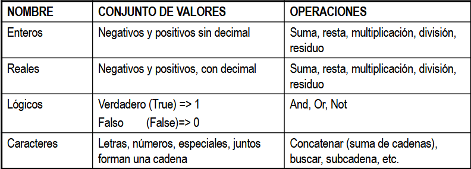
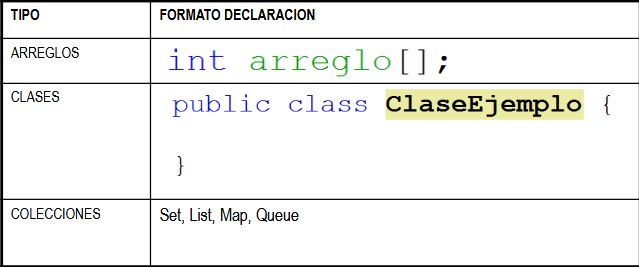
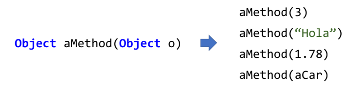
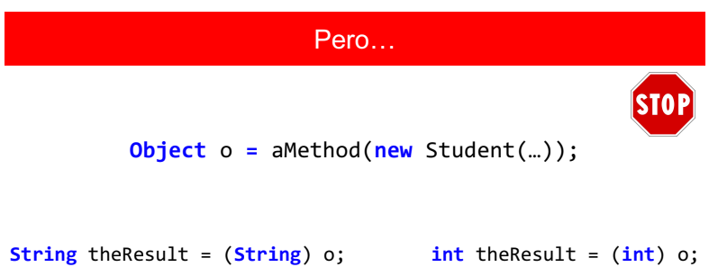
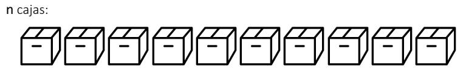
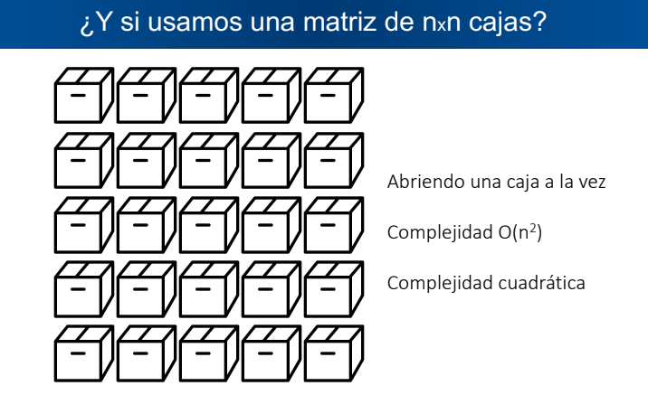
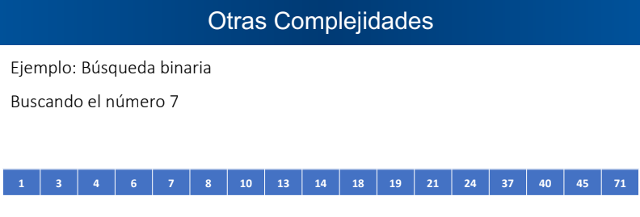
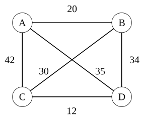
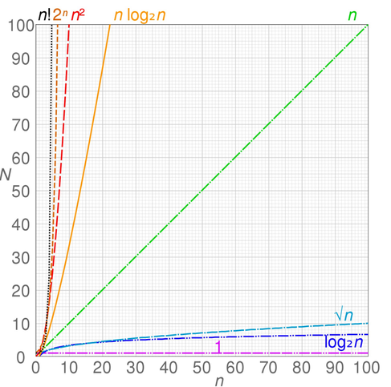

# Estructura de Datos

## Fundamentos: ¿Cómo entiende la computadora el mundo real?

Una computadora solo administra ceros y unos (`0` y `1`). Para que un programa resuelva problemas reales (como registrar una cédula, cobrar una multa o guardar un nombre), necesitamos **darle significado y reglas a esos bits en memoria**.

Clasificamos esos tipos de datos según **al dominio que pertenecen** (qué abarcan). Un dominio define dos cosas:

1. **El conjunto de valores válidos** (Qué se puede guardar).

2. **Las operaciones asociadas** (Qué tenemos permitido hacer con esos valores).

Los dominios se clasifican principalmente en:

* **Dominio Numérico:** Agrupa datos como edad, año de nacimiento o número de multas. Nos permiten hacer operaciones aritméticas.

* **Dominio Texto:** Agrupa datos como nombre, dirección o cédula. No se operan matemáticamente, sino mediante operaciones de cadena (concatenar, buscar subcadenas).

### Tipos de Datos Primitivos

El **Dominio** define la regla teórica y el **Tipo Primitivo de Java** es la casilla de memoria fija diseñada para cumplir esa regla. Es decir, que para ver la idea del Dominio de un dato en la práctica, Java dispone de los tipos de datos primitivos.

Un **Tipo de Dato Primitivo** es simplemente un tipo de realización física del Dominio (lo que se procesa en el Hardware). Son los tipos de datos más básicos e indivisibles que el lenguaje de programación ofrece de forma nativa. Representan un único valor directo en memoria.

 

Con esto, se puede ver que el dominio de los `String` sería de dominio texto, el de los `int` sería de dominio numérico, y así sucesivamente.

En el mundo real, la información no suele venir aislada en variables simples. Un estudiante no es solo un `int edad` suelto (sin una clase); es un conjunto de nombre, cédula, materias y promedios. Intentar manejar eso con puras variables primitivas sueltas vuelve el código inmanejable.

### Tipos de Datos Compuestos

Surgen para agrupar varios tipos de datos simples bajo una misma estructura y así representar entidades complejas del mundo real:

* Variables que almacenan más de un valor.

* Variables que representan información de la vida real.

* Estarán formados a partir de tipos de datos simples.

En Java tenemos:

 

Note que **la clase representa un tipo de dato compuesto**, ya que una simple `class Estudiante` podría conformarse de un `String nombre`, `int edad`, `boolean estaEstudiando`, entre otras. Por lo que se evidencia un conjunto de datos primitivos agrupados.

## La necesidad de manejar la complejidad: La Abstracción

Al agrupar datos en estructuras compuestas más grandes, surge un nuevo problema: si para usar una estructura tuvieras que conocer y modificar manualmente cada detalle interno de cómo está guardada en memoria, el software se volvería frágil e inmanejable.

> **Ejemplo:** Supón que quieres conducir un carro. Si **NO usaras abstracción**, tendrías que controlar manualmente la inyección de combustible, la chispa de las bujías, la presión del aceite y mover los engranajes de la transmisión. Un error de milisegundos destruye el motor. **Con abstracción**, el fabricante solo te da una interfaz simple: el pedal del acelerador **(te importa QUÉ HACE el carro, no CÓMO lo hace)**.

Para resolver esto, la ciencia de la computación aplica el principio de **Abstracción**.

> **Abstracción:** Es una visión simplificada de la realidad en la que solo consideramos los aspectos esenciales, haciendo énfasis en el **¿QUÉ HACE?** más que en el **¿CÓMO LO HACE?**.

En programación, la abstracción ocurre en dos niveles:

1. **Abstracción de Control:** Es la utilización de procedimientos o funciones sin preocuparse de cómo están implementados internamente. Solo nos interesa qué hace la función, ocultando detalles como variables temporales o secuencias de instrucciones. *Ejemplo:* al calcular el promedio de un conjunto de datos, solo te interesa pasar los datos, no el procedimiento matemático detrás de ello.

2. **Abstracción de Datos:** Permite definir nuevos tipos de datos enfocándonos en las operaciones que podemos realizar con ellos, sin importar cómo se almacenan en memoria. De este concepto nace el **TDA**.

Se le dice **Tipo de Dato Abstracto** porque el programador que diseñará ese tipo de dato sí se cuestionará el **cómo**. Sin embargo, está destinado para que otros programadores (o incluso el mismo programador) lo usen, reduciendo todo al interés del **qué hace**.

### Tipos de Datos Abstractos (TDAs) vs. Estructuras de Datos

Se llama **Abstracto** porque define una **idea** matemática/lógica pura (por ejemplo: *"una Pila es una estructura donde el último en entrar es el primero en salir"*) que existe conceptualmente antes de convertirse en código concreto en cualquier lenguaje.

Un **TDA** es un modelo matemático (es decir, teórico) de una `Estructura de Datos` que representa entidades del mundo real o conceptos abstractos, especificando el **QUÉ** y omitiendo el **CÓMO**.

> **Estructuras de Datos:** Es la forma concreta de **organizar, almacenar y gestionar datos en la memoria RAM** de la computadora para que puedan ser accedidos y modificados de manera eficiente. Si el **TDA** es el plano arquitectónico teórico (*el qué*), la **Estructura de Datos** es la construcción física con materiales concretos en memoria (*el cómo*).

### Componentes de un TDA

Un TDA bien diseñado se compone de dos partes fundamentales:

* **Comportamiento u Operaciones (Público):** Define lo que el TDA puede hacer. Es lo único que el programador usuario puede ver y utilizar.

  * *Ejemplo:* Un carro es útil porque se puede manejar; `manejar()` es una operación del TDA Carro.

* **Propiedades o Atributos (Oculto / Encapsulado):** Es la representación interna del estado y los datos. Un TDA correctamente creado **mantiene sus propiedades ocultas**.

  * *Ejemplo:* Al conductor no le interesa cómo el motor inyecta gasolina o cómo giran los pistones; solo le interesa que el carro avance al acelerar.

## Implementación de un TDA en Java

Para llevar un TDA del papel (modelo matemático) a un lenguaje orientado a objetos como Java, el lenguaje nos permite implementarlos mediante:

1. **Interfaces (`interface`):** Representan el TDA en su estado más puro. Solo definen el **QUÉ** (la firma de los métodos/operaciones) sin incluir detalles de implementación ni variables de estado.

2. **Clases Abstractas (`abstract class`):** Un punto medio. Permiten definir el contrato pero también compartir código o atributos comunes entre diferentes implementaciones.

3. **Clases Concretas (`class`):** Representan la **Estructura de Datos real**. Implementan la interfaz y definen el **CÓMO** (cómo se organizan físicamente los datos en la memoria RAM y cómo ejecutan los algoritmos).

### Caso de Estudio: El TDA `List` en Java

El TDA **`List`** representa una colección ordenada de elementos de cualquier tipo. Note que se le dice TDA ya que estamos hablando de una interfaz. Por lo cual, solo está establecido el qué hace `List<E>`, más no cómo lo hará.

```
                     ┌──────────────────┐
                     │     List<E>      │  <-- TDA / Interfaz
                     │   <interface>    │      (Especifica el QUÉ)
                     └────────┬─────────┘
                              │
               ┌──────────────┴──────────────┐
               │                             │
    ┌──────────┴──────────┐       ┌──────────┴──────────┐
    │    ArrayList<E>     │       │    LinkedList<E>    │  <-- Estructuras de Datos
    │ (Basado en Arrays)  │       │  (Basado en Nodos)  │      (Implementan el CÓMO)
    └─────────────────────┘       └─────────────────────┘
```

#### El Contrato (La Interfaz `List<E>`)

Define las reglas que toda lista debe cumplir en Java:

* Permite añadir, eliminar y recuperar elementos.

* Permite elementos duplicados.

* Las operaciones como `add()` o `remove()` informan el éxito o fracaso de la operación.

* **Operaciones clave:** `add(E e)`, `add(int index, E element)`, `clear()`, `contains(Object o)`.

#### Separación de Roles: Usuario vs. Implementador

Existe una separación radical de roles al trabajar con TDAs:

* **Para el Programador Cliente (Usuario del TDA):**

  * Tanto `ArrayList` como `LinkedList` se comportan exactamente igual a través de la interfaz `List`.

  * No necesita saber si los datos están contiguos en memoria o enlazados por referencias.

  * *Ejemplo:* `List<String> nombres = new ArrayList<>();`

* **Para el Desarrollador de la Estructura (Implementador):**

  * Debe tomar decisiones de ingeniería sobre la representación concreta en memoria.

  * **`ArrayList`:** Almacena los elementos en un arreglo interno redimensionable. Acceso por índice ultra rápido, pero inserciones en el medio costosas.

  * **`LinkedList`:** Almacena los elementos en nodos dispersos en memoria unidos por punteros/referencias. Inserciones rápidas, pero acceso por índice lento.

## ¿Cómo podemos construir nuestras propias estructuras?

Para poder programar nuestras propias versiones de `ArrayList`, `LinkedList`, `Pilas` y `Colas` desde cero en este curso, necesitamos dominar 3 herramientas fundamentales de Java y Algoritmos:

1. **Java Generics (`<T>` / `<E>`):** Para que nuestros TDAs puedan almacenar cualquier tipo de objeto sin perder la seguridad de tipos.

2. **Notación Asintótica (Big-O):** Para medir matemáticamente si es mejor usar `ArrayList` o `LinkedList` según el problema.

3. **Recursividad:** Para resolver problemas complejos dividiéndolos en subproblemas más simples.

## De los TDAs a Java Generics

### El Axioma del Contenedor

> **"La estructura y los algoritmos que gestionan los datos son totalmente independientes de la naturaleza de los datos gestionados."**

O dicho de otra forma:

> **"Una caja es una caja sin importar si guarda oro, joyas o discos duros. La lógica para abrirla, cerrarla o almacenar un elemento en ella es exactamente la misma."**

### El Dilema del Creador de TDAs

Cuando diseñas un **Tipo de Dato Abstracto (TDA)** como el TDA `List`:

* Defines las operaciones esenciales: `add()`, `remove()`, `get()`, `contains()`.

* El comportamiento matemático y la estructura lógica de una lista no cambian si guardas números enteros (`1, 2, 3`), texto (`"A", "B"`) o entidades del mundo real (`Estudiante`, `Laptop`, `Joya`).

Al traducir este modelo teórico a código Java, surgen dos problemas de diseño:

#### Opción A: Crear un TDA específico para cada tipo de dato

Escribir clases independientes como `IntArrayList`, `StringArrayList` o `StudentArrayList`.

* **Falla:** Causa **duplicación masiva de código**. No es una solución escalable ni fácil de mantener. Si se detecta un error en la lógica interna del método `add()`, habría que corregirlo en cada clase por separado.

#### Opción B: Crear un TDA utilizando la clase ancestro `Object`

Escribir una sola estructura basada en `Object`. Dado que toda clase hereda de `Object` en Java, la estructura puede almacenar cualquier tipo de elemento.

* **Falla:** Elimina la **seguridad de tipos (*Type Safety*)**. Obliga a realizar casting explícito al extraer los datos y genera riesgo de errores graves en tiempo de ejecución (*Runtime*) como un `ClassCastException` si se inserta un tipo de dato no esperado (es decir, le estás jurando a Java que sí se puede hacer un casting).

### El Corolario: Por qué nacen los Generics en Java

> **Corolario de Parametrización:**
> *"Para que un TDA sea verdaderamente abstracto y reutilizable, debe ser capaz de recibir el TIPO de dato como un parámetro de configuración en el momento de ser instanciado."*

**Java Generics (`<T>`)** resuelve esta necesidad al nivel del lenguaje:

1. **Abstracción Pura:** Permite escribir el algoritmo de la estructura de datos **una sola vez**.

2. **Seguridad en Tiempo de Compilación:** Evita el uso de castings manuales y permite que el compilador verifique que solo se almacenen los tipos permitidos, detectando incompatibilidades antes de ejecutar el programa.

## Java Generics (Parametrización de Tipos)

### La Evolución: De Parametrizar Datos a Parametrizar Tipos

Para entender por qué existen los Genéricos, debemos ver cómo evoluciona la reutilización de código en programación:

#### El Problema de la Duplicación Lógica

Imagina que necesitas métodos para dividir números entre valores fijos: `divideByTwo(n)`, `divideByThree(n)`, `divideByFour(n)`, ...

* **Falla:** Esta estrategia es **difícil de mantener**, **no es escalable** y es **demasiado específica**.

#### Primera Solución: Parametrización de Datos (Variables)

Pasamos el divisor como un argumento: `divideBy(int n, int divisor)`. Es lo que comúnmente llamamos **Parametrización de Datos**.

* **Ganancia:** Permite modificar el comportamiento del método enviando diferentes *valores* de datos sin reescribir la rutina. Así, hemos creado una solución **más genérica**.

#### El Nuevo Límite: ¿Y si queremos variar el TIPO de dato?

Si ahora queremos que un método o una clase funcione no solo con `int`, sino también con `String`, `Estudiante` o `Joya`, la parametrización de datos ya no alcanza. Por lo que hace falta generalizar.

* **La Solución (Parametrización de Tipos):** En lugar de pasar un *valor* como parámetro, pasamos un **TIPO DE DATO** como parámetro usando la sintaxis `<T>` **(Se la conoce como notación Diamante)**. 

La **Parametrización de Tipos** es la característica del lenguaje que permite crear clases, interfaces y métodos especificando los tipos de datos sobre los que operan mediante parámetros, en lugar de fijar un tipo de dato rígido desde el inicio.

Por otro lado, el **Parámetro de Tipo** es el identificador o símbolo *placeholder* (escrito formalmente entre llaves angulares `<>`) que representa un tipo de dato abstracto hasta que la clase o método es instanciado con un tipo real.

De esta forma, podemos crear clases, interfaces y métodos en los que los tipos de datos sobre los que opera se especifican como parámetros, obteniendo las siguientes ventajas:

* El código genérico trabaja automáticamente con el tipo de datos pasados a su parámetro de tipo.

  * *Ejemplo:* La búsqueda binaria es la misma ya sea que se esté buscando números, cadenas de caracteres, estudiantes, materias, etc.

* Con genéricos, se puede definir el algoritmo una vez y aplicarlo a varios tipos de datos sin mayor esfuerzo adicional.

### La Solución Antigua vs. La Solución Moderna

```
                  ¿Cómo almacenar cualquier tipo de dato?
                                     │
           ┌─────────────────────────┴─────────────────────────┐
           ▼                                                   ▼
 Usando Object (Antiguo)                             Usando Generics <T> (Moderno)
- Object es superclase de todos.                   - Define un parámetro de tipo <T>.
- Acepta cualquier objeto.                         - Mantiene el tipo específico en uso.
- Requiere Casts manuales.                         - No requiere Casts.
- Inseguro: Errores en Runtime.                    - Seguro: Errores en Compilación.
```

#### ¿Qué es un Genérico en Java?

Es el mecanismo general (introducido en Java 5) que permite definir estructuras y algoritmos tipo "plantilla" que funcionan automáticamente sobre cualquier tipo de dato asignado a su parámetro de tipo, garantizando seguridad en tiempo de compilación.

Como ya se ha visto, hay 2 formas de intentar lograr tipos de datos genéricos en Java:

1. Usando la clase `Object` (**NO recomendado**).

2. Usando **parámetros de tipo** (`<T>`).

### Clase `Object` para genéricos

Como se mencionó, `Object` fue la primera forma de intentar usar genéricos en Java. Esto sucedió así ya que, al ser `Object` la superclase de toda clase, una referencia de `Object` puede referirse a cualquier tipo de objeto.

 

Con esto obtenemos un método genérico. Sin embargo, considere los siguientes casos:



Al querer usar ese dato debemos hacer un casting. **¿Será que el objeto estudiante podrá ser transformado a texto?**, **¿Será que el objeto estudiante podrá ser un entero?**

Considere las siguientes observaciones al usar `Object`:

* **Casts necesarios** para convertir explícitamente de `Object` al tipo real de datos sobre los que se va a operar.

* **No es seguro:** Posibles errores durante tiempo de ejecución cuando los casts no son posibles.

### Ejemplo Práctico: Evolución de la clase `Box`

#### Implementación Rígida (Solo `String`)

Suponga que desea diseñar una clase que permita almacenar un artículo en una caja fuerte:

```java
public class Box {
  private String article = null;

  public Box(String article) {
    this.article = article;
  }

  public String getArticle() {
    return article;
  }

  public void setArticle(String article) {
    this.article = article;
  }
}
```

Prueba en el `main`:

```java
public class Main {
  public static void main(String[] args) {
    Box box1 = new Box("gold bar");
    Box box2 = new Box("crown");

    System.out.println(box1.getArticle());
    System.out.println(box2.getArticle());
  }
}
```

Con esta solución solo podríamos guardar elementos tipo `String`.

#### Intentando Generalizar con `Object`

```java
public class Box {
  private Object article = null;

  public Box(Object article) {
    this.article = article;
  }

  public Object getArticle() {
    return article;
  }

  public void setArticle(Object article) {
    this.article = article;
  }
}
```

Al probarlo en un `main`:

```java
public class Main {
  public static void main(String[] args) {
    Box box1 = new Box("gold bar");
    String article = box1.getArticle(); // ❌ Error de compilación: Object no es String
  }
}
```

Tenemos un error de compilación ya que un `Object` NO es un `String`. Por lo que tenemos que realizar un **Downcasting**:

```java
public class Main {
  public static void main(String[] args) {
    Box box1 = new Box("gold bar");
    String article = (String) box1.getArticle(); // Ok, pero peligroso e incómodo
  }
}
```

#### ¿Cuál es el problema de usar `Object` como contenedor?

Usar `Object` no es escalable en cuanto a **mantenimiento de software**:

1. **Sin Type Safety:** Permite mezclar cualquier tipo de dato en la misma estructura sin advertencias del compilador.

2. **Casteos redundantes:** Obliga al programador a realizar *downcasting* manual (`(Tipo)`) cada vez que recupera un elemento.

3. **Errores tardíos (`ClassCastException`):** Mueve la detección de errores del **tiempo de compilación** (seguro y rápido de corregir) al **tiempo de ejecución** (fallos graves en producción).

> **Conclusión:** Por estos tres problemas nacen los **Java Generics (`<T>`)**, permitiendo reutilizar código sin perder la seguridad de tipos.

#### La Solución Moderna: Clase Genérica `Box<T>`

Empleamos parametrización de tipos mediante el parámetro de tipo `<T>`:

```java
public class Box<T> {
  private T article = null;

  public Box(T article) {
    this.article = article;
  }

  public T getArticle() {
    return article;
  }

  public void setArticle(T article) {
    this.article = article;
  }
}
```

De esta forma, decimos que `Box` es **una clase genérica**. Al probarla en el `main`:

```java
public class Main {
  public static void main(String[] args) {
    Box<String> box1 = new Box<>("Joya");
    Box<Integer> box2 = new Box<>(1000);
    Box<Student> box3 = new Box<>(new Student("Adriana", "Collaguazo"));

    System.out.println(box1.getArticle());
    System.out.println(box2.getArticle());
    System.out.println(box3.getArticle());
  }
}
```

### Convenciones de Nombres para Parámetros de Tipo (`<T>`)

Por lo general, el parámetro de tipo suele denotarse con nombres simples expresados en letras mayúsculas:

* **`E` - Element:** Usado ampliamente por el Framework de Colecciones de Java (`List<E>`, `Set<E>`).

* **`K` - Key:** Representa la Clave en mapas (`Map<K, V>`).

* **`V` - Value:** Representa el Valor en mapas (`Map<K, V>`).

* **`N` - Number:** Para tipos numéricos.

* **`T` - Type:** Representa un Tipo general.

* **`S`, `U`, `V`:** Para múltiples parámetros de tipo adicionales.

### Puntos Importantes a Tener en Cuenta con `<T>`

* **Solo Tipos de Referencia (Objetos):** Los genéricos en Java no aceptan tipos primitivos directos (`int`, `double`, `boolean`, `char`). Se deben utilizar sus clases envolventes (*Wrapper classes*): `Integer`, `Double`, `Boolean`, `Character`.

* **Instancias**: Las instancias de una clase genérica con otra clase genérica pueden diferir de tipo. Por ejemplo
si tienes dos box (box1 -> String, box2 -> Integer). Realizar un box1 = box2.

* El parámetro de tipo **puede ser omitido**, pero tendrías que **realizar un Downcasting**.


## Notación Big-O / O grande / Asintótica
### ¿Qué es Big-O y por qué importa?
Si quieres saber si tu **algoritmo es rápido**, ¿por qué no simplemente usas un cronómetro? Es obvio
que el resultado **no es confiable**. Un algoritmo malo puede correr rápido en una supercomputadora,
y un algoritmo excelente puede correr lento en una tostadora xD.

Necesitábamos una forma de medir la **eficiencia independiente del hardware**. En lugar de contar segundos, la
solución es contar el **número de operaciones (pasos de la CPU)** que ejecuta el algoritmo en función del tamaño
de la **entrada (n) del algoritmo** (Como una función, por ejemplo).

Aquí es donde se conectan las Matemáticas y la Computación:

- En Matemáticas: La notación Big-O ya existía para analizar cómo se comporta una función cuando
su variable tiende al infinito.

- En Computación: Adoptamos esa misma herramienta matemática para responder: "Si la entrada n se hace
gigante (al infinito), **¿cuántas operaciones como máximo tendría que hacer la CPU?**" -> **Análisis**
**de desempaño**.

#### Análisis del desempeño
A nivel de análisis del desempeño, existen 3 tipos:
- Mejor de los casos.
- Caso promedio.
- Peor de los casos (Notación O grande).

Pero, ¿Por qué en este curso sólo nos enfocamos en el peor de los casos? 
Porque cuando **lanzamos un proyecto**, ya sea una aplicación de escritorio o móvil, nosotros
tenemos que **garantizar que esa aplicación funcione** cuando todos los usuarios las
estén usando, es decir, cuando **toda la organización la esté usando**. Eso implica evaluar
a la aplicación en su nivel de estrés más alto, dicho de otra forma, en el **peor de los casos**.


A nivel de computación, nosotros **usamos algoritmos**. Los algoritmos son secuencias
de pasos ordenados que nos ayudan a resolver un problema.

En un algoritmo pueden o no intervenir de x1 a x2, ..., xn variables (**entradas**) con el fin de 
obtener un resultado. Dicho resultado usará recursos computacionales -> **cantidad de memoria, unidades**
**de tiempo de disco duro, procesador**, ... Por lo que el **algoritmo tendrá un grado de complejidad**.

En estructura de datos, vamos a llamar a **la complejidad como el análisis del rendimiento**. 
Por tanto con Big-O evaluamos cuán complejo es un algoritmo en base a cuánta memoria utiliza, 
cuántas unidades de tiempo consume para **mostrar un resultado**. **Evaluamos la complejidad**
**en base a cuál es el peor de los casos del algoritmo** osea, cuál es el tope en complejidad
del algoritmo.

### Situación del regalo
Para entender mejor cómo interpretar la situación del peor de los casos, considere el siguiente
escenario:

Imagine que usted está buscando un regalo


#### Situación de las N cajas

En las n cajas que existen



Como usted es una sola persona, deberá abrir una caja a la vez. Es ahí 
donde el análisis O grande se pregunta:
¿En el **peor de los casos**, cuántas cajas habrá que abrir para encontrar el regalo?

Es evidente, que el peor de los casos es que el regalo se encuentre en **la última caja (la caja n)**.

Por tanto, a nivel de recursos computacionales está dependiendo y está relacionado
directamente con la cantidad de cajas (Depende de la cantidad que hay que recorrer, es decir
**depende de n**).

Dada una **entrada de tamaño n**, este algoritmo tiene una **complejidad O(n)**. Decimos que
la **complejidad de este algoritmo es lineal**.

Por último, las entradas son las cajas y lo que retorna el algoritmo es la ubicación del
regalo. Es decir, la complejidad O(n) se da por las **n entradas** que tendrá un algoritmo.

#### Situación de una matriz de nxn cajas

Ahora, deberá buscar el regalo en las n*n cajas que existen.



Como se puede observar, este algoritmo tendrá una **complejidad O(n^2)**. Si la matriz no fuese 
n*n, entonces, hablaríamos de una **complejidad O(n*m)**. Así, estamos hablando de una 
**complejidad cuadrática**.

### Otras complejidades
#### Búsqueda binaria O(Log(n))
Dejemos la situac iones de las cajas a un lado. Un buen ejemplo de otro tipo de complejidad
es la búsqueda binaria. De donde, dada una lista de números ordenados, debemos hallar un número cualquiera.



Para el efecto, el algoritmo es el siguiente: Empezamos a buscar en toda la lista de
números empezando por la mitad (Si es impar); ¿14 es menor o mayor que 7? Dado que
14 es mayor que 7, damos por hecho de que el número 7 está a la izquierda de la lista,
reduciendo la lista a la mitad izquierda. Al repetir este algoritmo N veces, obtenemos
el número 7.

Note que:

- **Paso 1**: n

2. **Paso 2** :n/2

3. **Paso 3**: n/4

...

4. **Paso k**: 1

Se puede observar que la **entrada n**, se reduce en cada paso.

Al repetir dicho algoritmo, estaremos dividiendo la lista poco a poco. Es decir, el algoritmo
divide los datos y descarta parte de ellos en cada paso. Por tanto, contamos con una
**complejidad logarítmica O(log(n))**. Por cierto, **la base del logaritmo es 2**.

#### Complejidad constante O(1)
Un perfecto ejemplo de esto es la suma de constantes. Por ejemplo, un algoritmo para
sumar a + b + c. Sin importar los valores de a, b o c, el algoritmo se ejecuta al 
mismo tiempo. Evidenciando así una **complejidad constante O(1)**

Se da cuando definimos variables, llamamos a funciones, ...

#### Complejidad Factorial O(n!)
Dada una lista de ciudades y las distancias entre cada par de ellas, ¿cuál es la ruta
más corta posible que visita cada ciudad exactamente una vez y al finalizar
regresa a la ciudad origen?



El peor de los casos sería probar todas las posiblidades. Imagine que no son 4
ciudades, sino 10. Así, tendríamos 3.628.800 operaciones XD. 

Cuando tengamos problemas en donde tengamos que recorrer múltiples nodos conforme
va aumentando la cantidad de nodos, incrementa también la complejidad. Contando con una 
**complejidad factorial O(n!)**.

### Complejidad de forma gráfica
**En resumen**: Describe cómo cambia el tiempo de ejecución de un algoritmo en función
del tamaño de la entrada.



### Importancia del O grande en este curso

La importancia radica en que **algunos algoritmos son mejores que otros**. Por ejemplo, **distintas**
**operaciones en un mismo TDA tienen distinta eficiencia** (La inserción de elementos en una estrcutura
de datos podría ser más eficiente que eliminar elementos). Sin embargo, en otros TDAs, puede ser
que esas mismas operaciones tengan otro **tipo de complejidad**.


